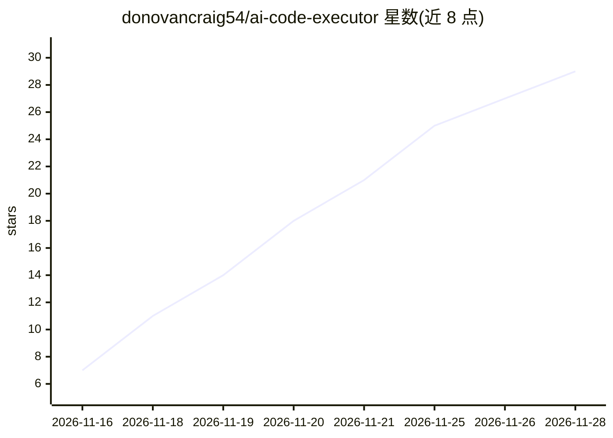

# donovancraig54/ai-code-executor

⭐ 29 · JavaScript · MIT · 推送 2026-11-13 · [GitHub](https://github.com/donovancraig54/ai-code-executor) · 个人维护

**为开发者提供的 AI 代码沙箱执行器：生成代码自动在 Docker 运行**

一个 Web 界面应用：用户向所选 AI 提问后，生成的代码自动在其专属 Docker 容器中执行，错误被检测后由 Auto-Fix 机制自动修复并重试（可配置最大尝试次数）。每个对话获得独立容器，预装 Python/Node/Rust/Java 等语言与构建工具，可配置 CPU/内存/存储/超时限制。内置浏览器终端、文件上传下载、容器镜像导出，支持桌面与移动端。接入 6 类 AI 服务，支持 API Key 或本地模型部署。

## 筛选速览

| 维度 | 判定 | 备注 |
|---|---|---|
| AI 角色 | `ai-native` | 本体是模型或模型工具 |
| 许可风险 | `permissive` | MIT |
| 部署形态 | `self-host` | docker 或自建部署 |
| 模型依赖 | local-ok | 支持本地模型 |
| 硬件要求 | — | 无带数字的原话,不猜 |
| 安装摩擦 | `low` | 无编译、无系统依赖或容器化 |
| 成熟度 | — | 结构信号不足 |

## 能力要点

- 每个对话自动创建隔离 Docker 容器，预装 Python/Node/Rust/Go/Java 等工具链
- Auto-Fix 系统：错误自动检测，最多 20 次自动修复重试
- 接入 Anthropic/OpenAI/Gemini 及 Ollama、LM Studio 本地模型，Whisper 语音输入
- 容器可一键导出为可移植 Docker 镜像，内置多标签浏览器终端

## 适用场景

- 让 AI 生成的代码无需复制粘贴即自动执行并验证
- 在隔离沙箱中安全运行 AI 代码，避免污染本机环境
- 离线/隐私场景下用本地模型生成并执行代码
- 导出容器镜像分享可复现的工作环境

## 场景标签

`编码 Agent` · 领域:编码与开发

## 证据(README 行号)

> L46: ✅ Auto-executed in Docker
> L142: ### 6 AI Providers - Choose Your Favorite (or Use Them All!)
> L210: ### 🦙 Ollama Integration - Free Local AI

## 星数曲线

2026-11-16 7 → 2026-11-28 29（+22）

---
*卡片 v1 · prompt 1.4 · 生成 2026-11-18 · 置信度 high · 依据 README sha `f0ec1657fa0e` · [字段定义](../../DATASET.md)*
