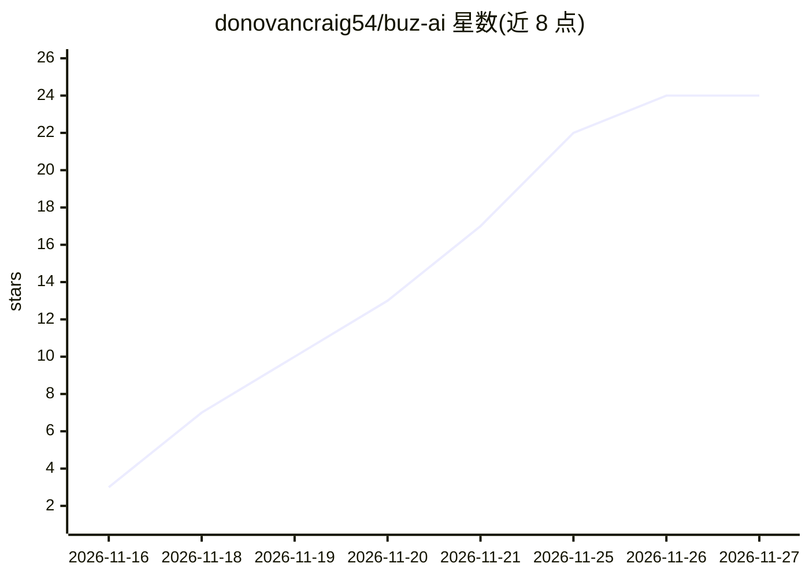

# donovancraig54/buz-ai

⭐ 24 · JavaScript · 推送 2026-11-15 · [GitHub](https://github.com/donovancraig54/buz-ai) · 个人维护

**面向企业与客服团队的 AI CRM 与客户支持平台**

基于 MERN 栈的 CRM 与客户支持平台，功能包括 AI 客服助手、实时聊天收件箱、客户管理、员工/团队管理、分析仪表盘、多商家账户，并内置 SaaS 定价与定制开发入口。技术栈为 MongoDB（含本地演示的内存回退）、Express REST API、React（Vite）与 Node.js。通过 npm 安装后以开发模式运行，提供演示登录账户，商业模式为月度 SaaS 订阅与定制开发。

## 筛选速览

| 维度 | 判定 | 备注 |
|---|---|---|
| AI 角色 | `ai-enhanced` | 去掉 AI 部分产品仍成立 |
| 许可风险 | `none` | — |
| 部署形态 | `library` | 以包/库形式分发 |
| 模型依赖 | — | README 未给出锁定关系 |
| 硬件要求 | — | 无带数字的原话,不猜 |
| 安装摩擦 | `low` | 无编译、无系统依赖或容器化 |
| 成熟度 | — | 结构信号不足 |

## 能力要点

- AI 客服助手与实时聊天收件箱
- 客户/员工/多商家账户管理
- 分析仪表盘
- MongoDB 内存回退支持本地演示

## 适用场景

- 管理客户资料与团队协作
- 通过实时聊天与 AI 助手处理客户咨询
- 查看客户与业务分析数据

## 场景标签

`聊天机器人` · 领域:对话与助手

## 证据(README 行号)

> L3: AI-powered CRM and customer support platform built with the MERN stack.
> L17: - AI customer service assistant

## 星数曲线

2026-11-16 3 → 2026-11-27 24（+21）

---
*卡片 v1 · prompt 1.4 · 生成 2026-11-19 · 置信度 high · 依据 README sha `3ec04fd52108` · [字段定义](../../DATASET.md)*
