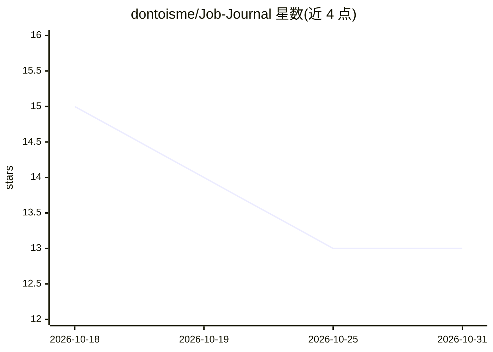

# dontoisme/Job-Journal

⭐ 13 · Python · MIT · 推送 2026-09-14 · [GitHub](https://github.com/dontoisme/Job-Journal) · 个人维护

**求职者自建经历语料库并生成定制简历的本地 CLI**

本地优先的 Python CLI：通过对话式访谈逐年逐角色提取成就与技能，存为可编辑的语料库（~/.job-journal/corpus.md）；申请时将语料与 JD 匹配，按 100 分制评分（摘要/技能/要点/关键词），生成简历时逐条从语料选取原文而非 AI 编造。另含 Greenhouse/Lever/Ashby 职位搜索、Gmail 邮件追踪、Google Docs 导出与后台同步 worker。以 Claude Code 斜杠命令为主要界面，所有数据留在本机。

## 筛选速览

| 维度 | 判定 | 备注 |
|---|---|---|
| AI 角色 | `ai-native` | 本体是模型或模型工具 |
| 许可风险 | `permissive` | MIT |
| 部署形态 | `library` | 以包/库形式分发 |
| 模型依赖 | locked-api |  |
| 硬件要求 | — | 无带数字的原话,不猜 |
| 安装摩擦 | `low` | 无编译、无系统依赖或容器化 |
| 成熟度 | — | 结构信号不足 |

## 能力要点

- 对话式访谈构建个人经历语料库，可全文检索与编辑
- 简历要点从语料逐条选取，声明不做 AI 编造
- 100 分制简历-JD 匹配评分（4 类权重）
- Greenhouse/Lever/Ashby 职位搜索与 Gmail 申请邮件追踪

## 适用场景

- 通过访谈沉淀自己的工作经历，随时生成针对 JD 的简历
- 搜索招聘板职位并按语料匹配度评分
- 追踪投递状态与面试/拒信邮件，查看流程统计

## 场景标签

`知识库管理` `AI 写作` · 领域:内容生成

## 证据(README 行号)

> L5: Job Journal is a local-first CLI tool that helps you build a rich corpus of your professional experience through con
> L34: 4. **Apply** -- Job Journal matches your corpus against the job description and generates a tailored resume. Every 

## 星数曲线

2026-10-18 15 → 2026-10-31 13（-2）

---
*卡片 v1 · prompt 1.4 · 生成 2026-10-31 · 置信度 mid · 依据 README sha `f41225ad5721` · [字段定义](../../DATASET.md)*
