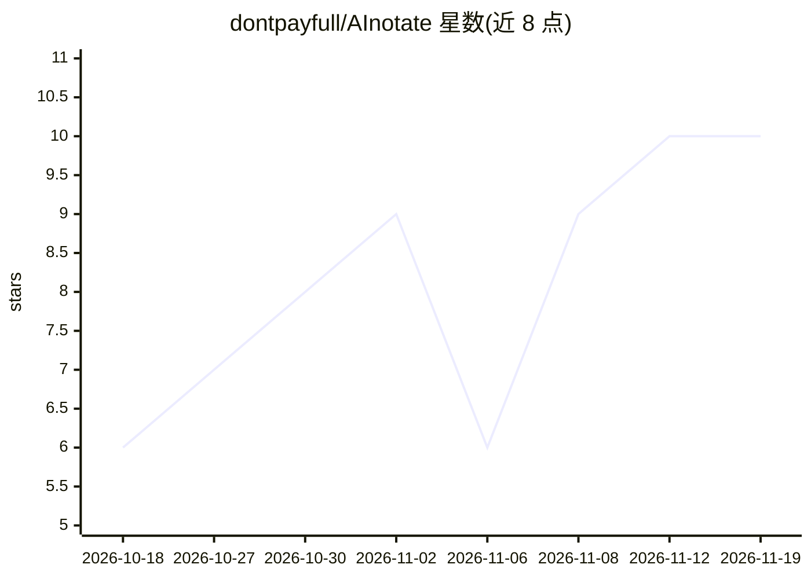

# dontpayfull/AInotate

⭐ 10 · Python · AGPL-3.0 · 推送 2026-10-23 · [GitHub](https://github.com/dontpayfull/AInotate) · [官网](https://www.dontpayfull.com/labs/ainotate/) · 组织维护

**给 AI agent 用的截图标注工具：把操作步骤画在图上**

MCP 服务器 + CLI + Python 库三种形态，供 agent 或人直接生成带标注的截图：捕获网页、窗口或已有图片，定位目标元素后绘制编号步骤、箭头、方框、标签与不透明遮挡，并在交付前自检图像。标签与箭头自动规划摆放位置以避开正文，网页截图默认自动遮挡邮箱、令牌等敏感信息。支持接入 Claude Code、Claude Desktop、Codex、Gemini CLI、Cursor 等 MCP 客户端；macOS 功能经验证，Windows/Linux 为实验性。本地运行，除加载待截图页面外不自行发起网络请求。

## 筛选速览

| 维度 | 判定 | 备注 |
|---|---|---|
| AI 角色 | `ai-native` | 本体是模型或模型工具 |
| 许可风险 | `viral` | AGPL-3.0 |
| 部署形态 | `library` | 以包/库形式分发 |
| 模型依赖 | — | README 未给出锁定关系 |
| 硬件要求 | — | 无带数字的原话,不猜 |
| 安装摩擦 | `low` | 无编译、无系统依赖或容器化 |
| 成熟度 | — | 结构信号不足 |

## 能力要点

- 多种标注标记：编号步骤、箭头（4 种样式）、方框、放大镜、键帽、高亮、不透明遮挡等
- 标签自动避让正文内容，多个标签联合规划位置
- 网页截图自动扫描并遮挡邮箱、电话、API key、JWT 等敏感信息
- OCR 定位（Apple Vision/Windows OCR/Tesseract）与 macOS Accessibility API 精确标注 UI 控件

## 适用场景

- 让 agent 回答"在哪里点"时直接发标注截图而不是文字描述
- 生成带编号步骤的 Markdown/HTML/PDF 操作指南
- 制作 bug 报告工单：标出问题位置并自动遮挡邮箱与令牌
- UI 变更后按同一 spec 重拍文档与更新日志截图

## 场景标签

`图像视频处理` · 领域:感知与多模态

## 证据(README 行号)

> L11: MCP server
> L20: It captures a web page, a window or a screenshot you already have, finds
> L24: Codex, Gemini CLI, Cursor and any other MCP client, and from the command

## 星数曲线

2026-10-18 6 → 2026-11-19 10（+4）

---
*卡片 v1 · prompt 1.4 · 生成 2026-11-19 · 置信度 low · 依据 README sha `c63c58cd9ac0` · [字段定义](../../DATASET.md)*
