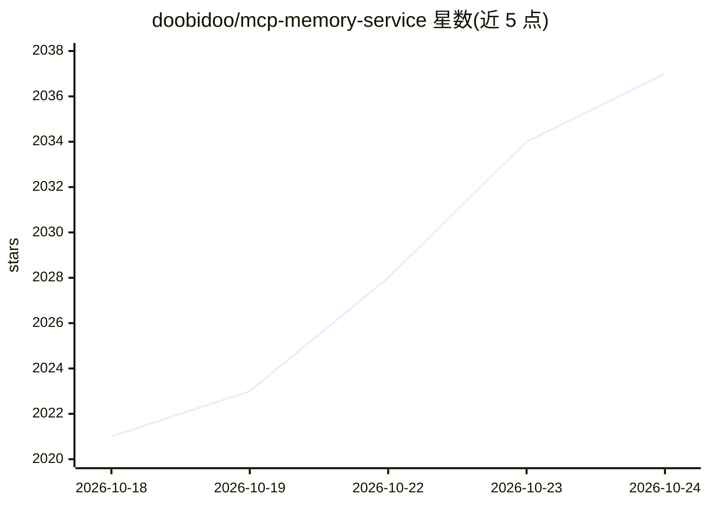

# doobidoo/mcp-memory-service

⭐ 2,038 · Python · Apache-2.0 · 推送 2026-10-24 · [GitHub](https://github.com/doobidoo/mcp-memory-service) · 个人维护

**AI agent 流水线的自托管持久共享记忆后端**

面向 LangGraph、CrewAI、AutoGen、Claude 等客户端的自托管记忆服务，通过 MCP、REST API、OAuth、CLI 与 Web 仪表盘提供统一接入。核心机制：持久存储决策与项目上下文、语义+BM25 混合检索、带类型边的知识图谱与实体抽取、按 X-Agent-ID 标签做范围检索、自主整合（聚类/压缩/遗忘）与矛盾检测；嵌入通过本地 ONNX 运行，核心存储支持 SQLite，可选 Cloudflare、Hybrid、Milvus 后端。Apache 2.0 许可，由个人维护。

## 筛选速览

| 维度 | 判定 | 备注 |
|---|---|---|
| AI 角色 | `ai-ecosystem` | LLM/agent 周边工具 |
| 许可风险 | `permissive` | Apache-2.0 |
| 部署形态 | `library` | 以包/库形式分发 |
| 模型依赖 | local-ok | 支持本地模型 |
| 硬件要求 | — | 无带数字的原话,不猜 |
| 安装摩擦 | `low` | 无编译、无系统依赖或容器化 |
| 成熟度 | — | 结构信号不足 |

## 能力要点

- 框架无关 REST API 与 MCP 双通道接入（Claude Desktop/Code、OpenCode、Codex 等）
- 知识图谱与带类型边的关系（causes/fixes/contradicts）及实体抽取
- 本地 ONNX 嵌入与 SQLite 本地优先存储，可选 Cloudflare/Hybrid/Milvus 后端
- 自主整合（聚类、压缩、受控遗忘）与矛盾检测、置信度评分

## 适用场景

- 让 Claude Code/Claude Desktop 等客户端跨会话记住项目上下文
- 多 agent 流水线通过 REST API 共享与检索记忆
- 本地部署一套无云依赖的记忆服务，多设备经 Remote MCP 同步

## 场景标签

`Agent 记忆` `知识图谱` · 领域:Agent 开发

## 证据(README 行号)

> L5: Open-source memory backend for AI agents — **REST API, MCP, OAuth, CLI, dashboard**. One self-hosted service, every 
> L9: **Works with LangGraph · CrewAI · AutoGen · any HTTP client · Claude Desktop · OpenCode**
> L81:  Agent pipelines (REST API — LangGraph, CrewAI, AutoGen, any HTTP client)

## 星数曲线

2026-10-18 2,021 → 2026-10-24 2,037（+16）

---
*卡片 v1 · prompt 1.4 · 生成 2026-10-21 · 置信度 high · 依据 README sha `0ea47a0f3880` · [字段定义](../../DATASET.md)*
