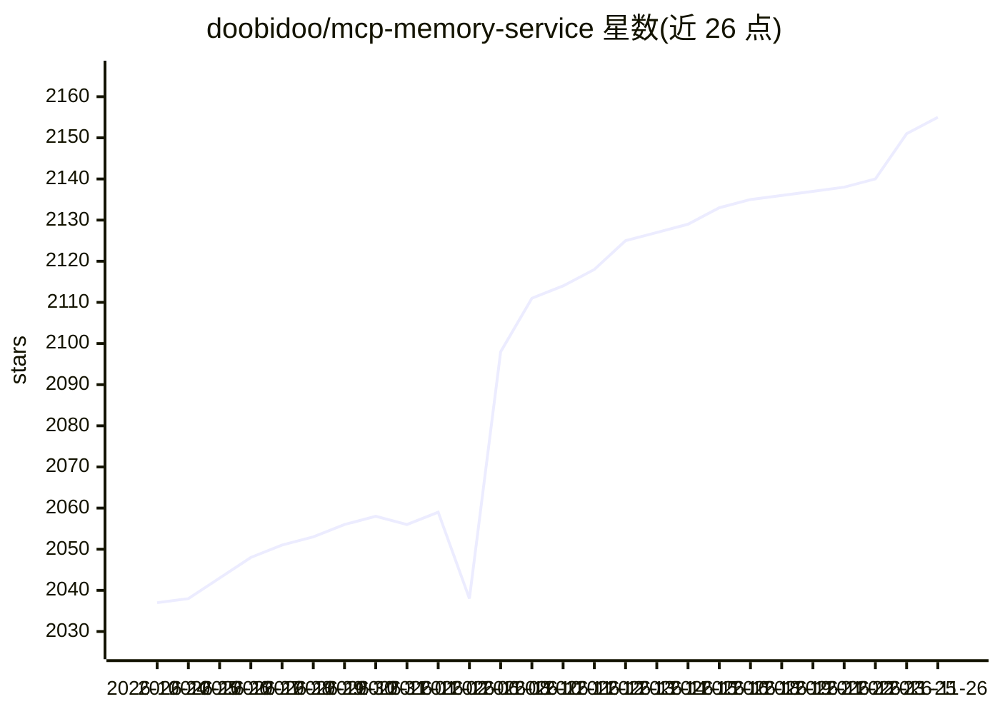

# doobidoo/mcp-memory-service

⭐ 2,155 · Python · Apache-2.0 · 推送 2026-11-25 · [GitHub](https://github.com/doobidoo/mcp-memory-service) · 组织维护

**为 AI agent 管线提供自托管持久记忆的服务**

以 MCP 服务器与 REST API 两种形态提供的开源持久记忆后端：agent 将决策与上下文写入共享知识图谱，支持带类型因果边的语义/关键词混合检索、按 agent 身份与标签的分级检索、自动压缩与矛盾处理的整合机制。嵌入通过本地 ONNX 运行；后端可选 SQLite、Cloudflare、Hybrid 或 Milvus。面向构建 agent 管线（LangGraph/CrewAI/AutoGen）及使用 Claude 等客户端的用户，Apache 2.0 许可。

## 筛选速览

| 维度 | 判定 | 备注 |
|---|---|---|
| AI 角色 | `ai-ecosystem` | LLM/agent 周边工具 |
| 许可风险 | `permissive` | Apache-2.0 |
| 部署形态 | `self-host` | docker 或自建部署 |
| 模型依赖 | local-ok | 支持本地模型 |
| 硬件要求 | — | 无带数字的原话,不猜 |
| 安装摩擦 | `low` | 无编译、无系统依赖或容器化 |
| 成熟度 | — | 结构信号不足 |

## 能力要点

- 框架无关 REST API、MCP、OAuth、CLI、dashboard 多种接入方式
- 带类型因果边的知识图谱与实体抽取
- 本地 ONNX 嵌入，记忆不离开自托管基础设施
- 自主整合：聚类、压缩、关联发现与受控遗忘

## 适用场景

- 让 LangGraph/CrewAI/AutoGen 多 agent 共享项目决策上下文
- Claude Desktop/Code 跨会话记住架构决策与代码模式
- 自托管部署避免云端记忆服务的锁定与 API 费用

## 场景标签

`Agent 记忆` `知识图谱` · 领域:Agent 开发

## 证据(README 行号)

> L5: Open-source memory backend for AI agents — **REST API, MCP, OAuth, CLI, dashboard**. One self-hosted service, every 
> L45: - **Framework-agnostic REST API** — no MCP client library needed; the live endpoint list is at `/api/docs`
> L174: - **Agent frameworks (REST):** LangGraph · CrewAI · AutoGen · OpenClaw/Nanobot · any HTTP client

## 星数曲线

2026-10-24 2,037 → 2026-11-26 2,155（+118）

---
*卡片 v1 · prompt 1.4 · 生成 2026-11-24 · 置信度 mid · 依据 README sha `5ffa5a887a67` · [字段定义](../../DATASET.md)*
