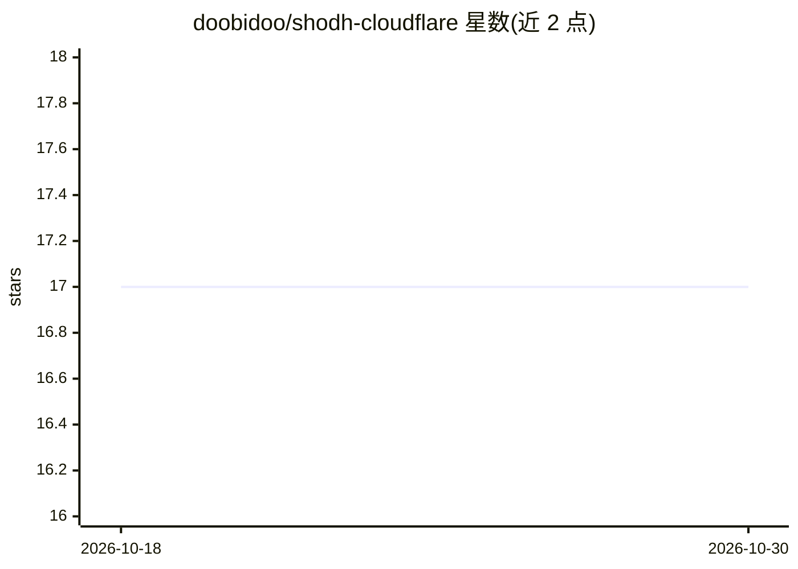

# doobidoo/shodh-cloudflare

⭐ 17 · TypeScript · MIT · 推送 2026-10-18 · [GitHub](https://github.com/doobidoo/shodh-cloudflare) · 个人维护

**跨设备同步的 AI 记忆服务：Cloudflare 边缘存储与语义检索**

部署在 Cloudflare Workers 上的 AI 记忆后端：用 D1(SQLite) 存储记忆、Vectorize 做语义检索、Workers AI 生成嵌入（bge-small-en-v1.5, 384 维）并对语音输入做纠错、分类与标签生成。通过 MCP 桥接接入 Claude Desktop、Gemini CLI、Cursor、VS Code 等客户端，实现笔记本/手机/平板间的全局上下文同步。v2.0 支持英德双语 65+ 自然语言时间查询、ISO 8601 周历、AI 摘要与记忆巩固。需自部署 Worker，前置要求为 Cloudflare 账户与 Node.js 18+。

## 筛选速览

| 维度 | 判定 | 备注 |
|---|---|---|
| AI 角色 | `ai-ecosystem` | LLM/agent 周边工具 |
| 许可风险 | `permissive` | MIT |
| 部署形态 | `library` | 以包/库形式分发 |
| 模型依赖 | — | README 未给出锁定关系 |
| 硬件要求 | — | 无带数字的原话,不猜 |
| 安装摩擦 | `low` | 无编译、无系统依赖或容器化 |
| 成熟度 | — | 结构信号不足 |

## 能力要点

- Cloudflare Workers + D1 + Vectorize 的边缘部署，声明全球 <50ms 延迟
- MCP 工具集：remember/recall/forget/consolidate 等 13 个
- 65+ 英德双语自然语言时间查询与 ISO 8601 周历（KW）支持
- 语音输入自动 AI 分类：纠错、类型判定、生成 2-4 个标签

## 适用场景

- 在多台设备间保持 AI 助手的项目上下文与决策记忆
- 通过 Siri 快捷指令/Apple Watch 用语音记录并按时间回忆
- 让 Claude/Cursor/VS Code 等客户端通过 MCP 共享同一记忆库

## 场景标签

`Agent 记忆` · 领域:Agent 开发

## 证据(README 行号)

> L116: This system can be integrated with any AI client that supports the Model Context Protocol (MCP) or can have its be
> L63: | **Device Bridge** | Node.js MCP | Works with Claude, Cursor, VS Code
> L59: |**Edge API**|Cloudflare Workers|REST API in 300+ cities worldwide|

## 星数曲线

2026-10-18 17 → 2026-10-30 17（+0）

---
*卡片 v1 · prompt 1.4 · 生成 2026-10-29 · 置信度 mid · 依据 README sha `8b1818d830f9` · [字段定义](../../DATASET.md)*
