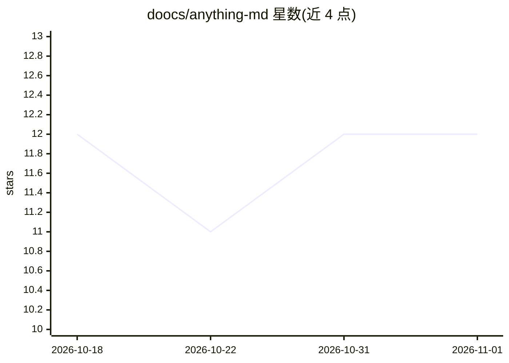

# doocs/anything-md

⭐ 12 · TypeScript · MIT · 推送 2026-10-17 · [GitHub](https://github.com/doocs/anything-md) · 组织维护 · 中文 README

**部署在 Cloudflare Workers 上的 URL/文档转 Markdown API 服务**

基于 Cloudflare Workers 与 Workers AI toMarkdown 模型构建的轻量 API 服务：传入 URL 自动抓取页面，或直接传递内容，转换为结构化 Markdown；支持 PDF、HTML、Office 文档、图片、CSV 等格式，图片可由 Workers AI 模型生成文字摘要。面向需要 RAG 数据预处理、LLM 语料采集或为 Agent 提供网页阅读能力的开发者，clone 后修改 wrangler.jsonc 配置即可部署到自己的 Workers，按量计费，无需自建服务器。

## 筛选速览

| 维度 | 判定 | 备注 |
|---|---|---|
| AI 角色 | `ai-ecosystem` | LLM/agent 周边工具 |
| 许可风险 | `permissive` | MIT |
| 部署形态 | `library` | 以包/库形式分发 |
| 模型依赖 | — | README 未给出锁定关系 |
| 硬件要求 | — | 无带数字的原话,不猜 |
| 安装摩擦 | `low` | 无编译、无系统依赖或容器化 |
| 成熟度 | — | 结构信号不足 |

## 能力要点

- URL 或直接内容输入，输出结构化 Markdown
- 支持 PDF/HTML/Office/图片/CSV 等多格式转换
- 图片经 Workers AI 模型生成文字摘要
- 内置指数退避重试、15s 超时与 CORS 跨域支持

## 适用场景

- 为 RAG 流水线做网页与文档的 Markdown 预处理
- 为 LLM 训练采集结构化语料
- 给 AI Agent 提供网页内容读取能力

## 场景标签

`文档解析` · 领域:知识与检索

## 证据(README 行号)

> L9: Anything-MD 是一个部署在 Cloudflare Workers 上的轻量 API 服务。你可以传入一个 URL 让它自动抓取页面内容，或直接传递内容，然后利用 Workers AI toMarkdown 将其转换为结构化
> L11: 适用于 RAG 数据预处理、LLM 训练语料采集、AI Agent 的网页阅读能力等场景。

## 星数曲线

2026-10-18 12 → 2026-11-01 12（+0）

---
*卡片 v1 · prompt 1.4 · 生成 2026-11-01 · 置信度 mid · 依据 README sha `1cf47728ac5d` · [字段定义](../../DATASET.md)*
