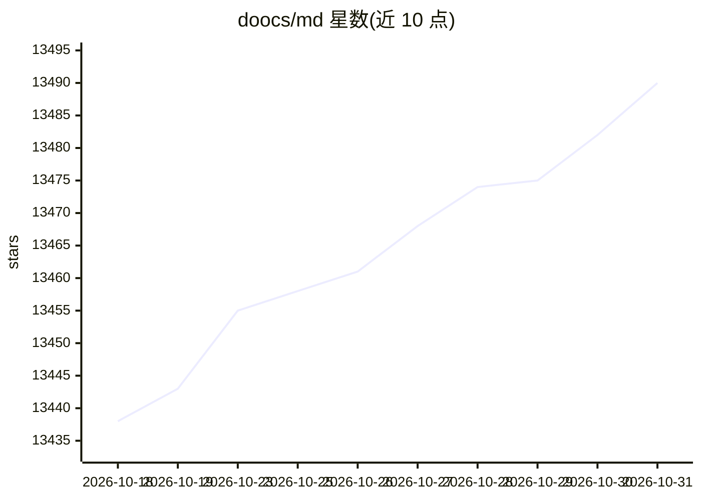

# doocs/md

⭐ 13,490 · TypeScript · WTFPL · 推送 2026-10-30 · [GitHub](https://github.com/doocs/md) · [官网](https://md.doocs.org) · 组织维护 · 中文 README

**给公众号创作者的微信 Markdown 排版编辑器**

将 Markdown 即时渲染为微信图文的编辑器，减少公众号排版调整工作。功能覆盖标准 Markdown、KaTeX 数学公式、Mermaid/PlantUML 图表、代码高亮主题、本地草稿管理与内容导出导入；支持 13 类图床上传（GitHub、阿里云、腾讯云、S3 协议等）；集成 DeepSeek、OpenAI、通义千问等模型辅助内容创作。在线版可直接使用，另提供 npm CLI 与 Docker 私有化部署方式。

## 筛选速览

| 维度 | 判定 | 备注 |
|---|---|---|
| AI 角色 | `ai-enhanced` | 去掉 AI 部分产品仍成立 |
| 许可风险 | `viral` | WTFPL |
| 部署形态 | `self-host` | docker 或自建部署 |
| 模型依赖 | — | README 未给出锁定关系 |
| 硬件要求 | — | 无带数字的原话,不猜 |
| 安装摩擦 | `low` | 无编译、无系统依赖或容器化 |
| 成熟度 | — | 结构信号不足 |

## 动量与使用信号

- 维护:`active` — 距上次 push 1.3 天,年发版 0,57 位贡献者
- 涨星:近 1 天 **+9**(自 20261016 起算)
- 安装:npm 包 `@doocs/md-cli` 月下载 333

## 能力要点

- Markdown 即时渲染为微信图文，支持 KaTeX、Mermaid、PlantUML、Ruby 注音
- 13 种图床上传选项（GitHub、阿里云、腾讯云、MinIO、S3、Cloudflare R2 等）
- 集成 DeepSeek、OpenAI、通义千问、腾讯混元、火山方舟等模型辅助创作
- 提供在线版、npm CLI、Docker 三种使用与部署方式

## 适用场景

- 为微信公众号文章做 Markdown 排版与样式转换
- 写公众号时把图片上传到多种图床并生成外链
- 私有化部署一套自己的 Markdown 图文编辑器
- 借助 AI 模型辅助内容创作

## 场景标签

`AI 写作` · 领域:内容生成

## 证据(README 行号)

> L11: **Markdown 文档自动即时渲染为微信图文**，让你不再为公众号排版发愁。只需掌握基本的 Markdown 语法，即可生成样式简洁、美观大方的微信图文。
> L37: - 集成主流 AI 模型（DeepSeek、OpenAI、通义千问、腾讯混元、火山方舟、302.AI 等），辅助内容创作
> L96: docker run -d -p 8080:80 doocs/md:latest

## 星数曲线

2026-10-18 13,438 → 2026-10-31 13,490（+52）

---
*卡片 v1 · prompt 1.4 · 生成 2026-10-18 · 置信度 high · 依据 README sha `e483e2f8599e` · [字段定义](../../DATASET.md)*
