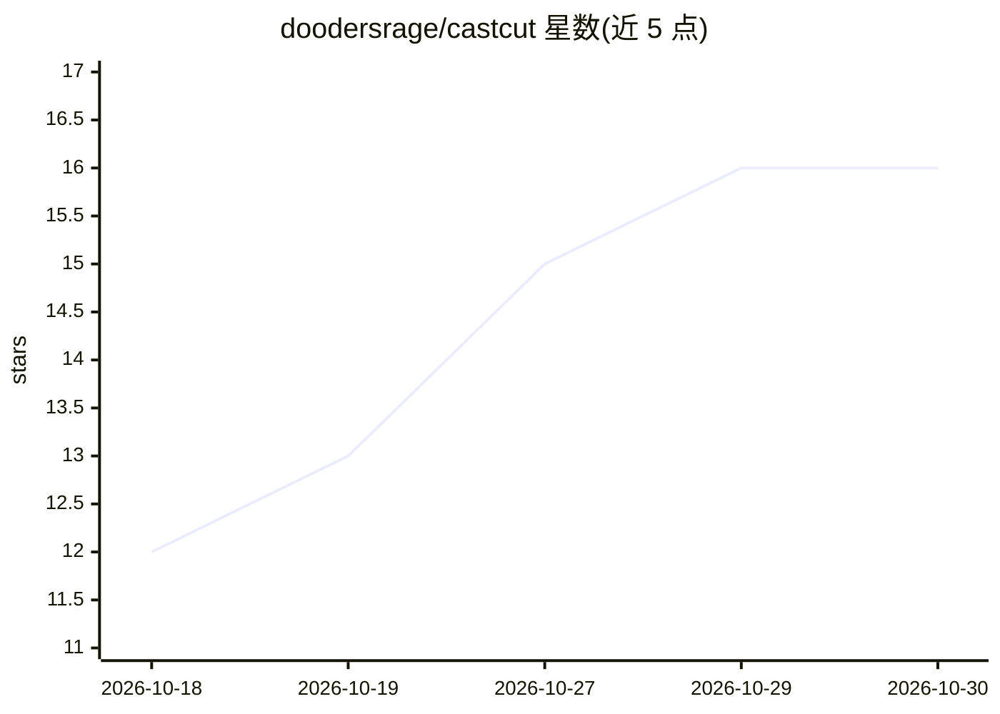

# doodersrage/castcut

⭐ 16 · TypeScript · MIT · 推送 2026-10-29 · [GitHub](https://github.com/doodersrage/castcut) · [官网](https://doodersrage.github.io/castcut/) · 个人维护

**本地 AI 角色短片创作工具：用 ComfyUI 生成一致角色的图像与影片**

面向个人创作者的本地角色短片制作应用：先建立角色（Cast），再搭配服装、按一天的时刻规划场景，可选 LLM 生成后续剧情，最终在 Cut 步骤剪辑、配乐、加字幕并导出。生成与渲染依托 ComfyUI 工作流，静态图引擎含 Qwen-Image、FLUX.2 Klein，视频引擎含 LTX-2.5、WAN 2.2，并提供唇同步、重打光、超分插帧等修整工具。提供桌面安装包与 Docker 镜像，需 Node.js 22+ 与可达的 ComfyUI；角色一致性通过单一面部板与服装板机制实现。

## 筛选速览

| 维度 | 判定 | 备注 |
|---|---|---|
| AI 角色 | `ai-native` | 本体是模型或模型工具 |
| 许可风险 | `permissive` | MIT |
| 部署形态 | `desktop` | 安装包/桌面程序 |
| 模型依赖 | local-ok | 支持本地模型 |
| 硬件要求 | — | 无带数字的原话,不猜 |
| 安装摩擦 | `low` | 无编译、无系统依赖或容器化 |
| 成熟度 | — | 结构信号不足 |

## 能力要点

- Cast→Outfit→Day→Cut 流程，单一角色面部/服装板保证跨图一致性
- 依托 ComfyUI 工作流队列与可选 Castcut 自定义节点
- 内置 llama.cpp 语言/视觉模型，可指向 LM Studio / Ollama
- 提供 3D 姿态编辑器与镜头参数（高度/方向/景别/镜头）控制

## 适用场景

- 围绕同一角色创作一组连贯的图像或短片
- 制作带对白、唇同步与配乐的竖屏/方屏/宽屏短片
- 在本地 ComfyUI 环境完成从角色设定到剪辑导出的全流程

## 场景标签

`图像生成` `视频生成` · 领域:内容生成

## 证据(README 行号)

> L11: **Make a character, give her a day, cut the film — locally, with ComfyUI.** One consistent person across every stil
> L53: Requires **Node.js 22+** and a reachable **ComfyUI**.
> L93: |**Stills**|Qwen-Image 2.1 Turbo (default), Qwen-Image 2.1 Noct-Q / Noct-Q Fast, Qwen-Image-Edit 2511, Qwen Rapid A

## 星数曲线

2026-10-18 12 → 2026-10-30 16（+4）

---
*卡片 v1 · prompt 1.4 · 生成 2026-10-30 · 置信度 mid · 依据 README sha `4cd38e8e8cf6` · [字段定义](../../DATASET.md)*
