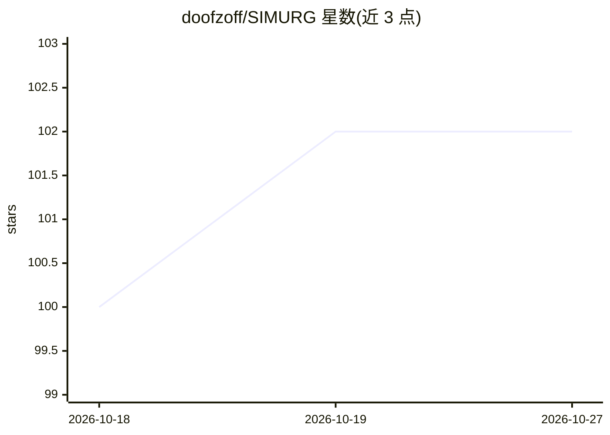

# doofzoff/SIMURG

⭐ 102 · Python · Apache-2.0 · 推送 2026-09-21 · [GitHub](https://github.com/doofzoff/SIMURG) · 组织维护

**LLM 流式解码损坏检测库：生成中拦截重复/漂移/垃圾输出**

面向生产环境 LLM 服务的流式输出完整性监控库：对 token 流做 O(1) 逐字符特征提取（重复率、脚本分布、压缩率等），经规则层与在线逻辑回归学习层检测重复崩溃、跨语言漂移、模板泄漏等解码损坏，采用共形校准控制误报率。零泄漏协议在开头 hold 窗口内验证后才放行，损坏发生时中止并触发重试与回退模型。兼容任意 OpenAI 端点，numpy 依赖，支持用自有语料重校准与训练自定义失效检测器。明言不检测流畅但事实错误的幻觉。

## 筛选速览

| 维度 | 判定 | 备注 |
|---|---|---|
| AI 角色 | `ai-ecosystem` | LLM/agent 周边工具 |
| 许可风险 | `permissive` | Apache-2.0 |
| 部署形态 | `library` | 以包/库形式分发 |
| 模型依赖 | local-ok | 支持本地模型 |
| 硬件要求 | — | 无带数字的原话,不猜 |
| 安装摩擦 | `low` | 无编译、无系统依赖或容器化 |
| 成熟度 | — | 结构信号不足 |

## 能力要点

- 零泄漏协议：开头 350 字符 hold 验证后才放行，损坏触发 abort/retry/回退模型
- 五检测器集成：字符 n-gram 惊讶度、Count-Min 重复、SimHash 漂移、自校准 z 分数、规则层
- 共形校准提供有限样本误报率保证，误报预算可配置
- 规则层零训练可用，15 权重在线逻辑回归持续学习，197k chars/sec CPU 吞吐

## 适用场景

- 生产环境中拦截自托管/量化模型的重复循环或语言漂移输出
- 为任意 OpenAI 兼容端点加流式防护与自动重试
- 用自有流量重校准阈值并训练领域失效模式检测器

## 场景标签

`LLM 可观测性` · 领域:评测与运维

## 证据(README 行号)

> L80: SIMURG is a **streaming hallucination and output-degradation detector for
> L233: ### 1. Guard any OpenAI-compatible endpoint (3 lines)

## 星数曲线

2026-10-18 100 → 2026-10-27 102（+2）

---
*卡片 v1 · prompt 1.4 · 生成 2026-10-23 · 置信度 high · 依据 README sha `bf6599969f42` · [字段定义](../../DATASET.md)*
