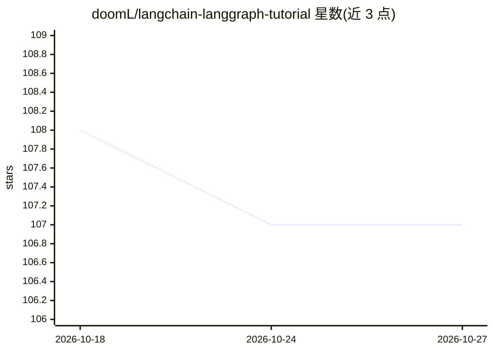

# doomL/langchain-langgraph-tutorial

⭐ 107 · Jupyter Notebook · 推送 2026-08-24 · [GitHub](https://github.com/doomL/langchain-langgraph-tutorial) · 个人维护

**LangChain/LangGraph/LangSmith 实战教程集：25 个 Jupyter notebook**

面向学习者的 Python 教程仓库，以 25 个自包含 Jupyter notebook 覆盖 LangChain 基础（链、Agent、RAG、记忆）、LangGraph 图工作流、进阶模式（HITL、Supervisor、Swarm、时间旅行、Functional API）与前沿主题（Deep Agents、LangChain 1.0 工具、Middleware、MCP/A2A 协议）。全部教程使用 Groq 免费层推理（llama-3.1-8b-instant 与 qwen3-32b），通过 .env 配置 API key 运行，需 Python 3.10+，不要求先验 LangChain 经验。MIT 许可。

## 筛选速览

| 维度 | 判定 | 备注 |
|---|---|---|
| AI 角色 | `ai-knowledge` | 知识聚合/清单类 |
| 许可风险 | `permissive` | — |
| 部署形态 | `library` | 以包/库形式分发 |
| 模型依赖 | locked-api |  |
| 硬件要求 | — | 无带数字的原话,不猜 |
| 安装摩擦 | `low` | 无编译、无系统依赖或容器化 |
| 成熟度 | — | 结构信号不足 |

## 能力要点

- 25 个自包含 Jupyter notebook，四个阶段递进（基础→LangGraph→进阶模式→前沿）
- 全部示例基于 Groq 免费层推理（llama-3.1-8b-instant、qwen3-32b）
- 覆盖 Corrective RAG、Supervisor、Swarm、Deep Agents、MCP & A2A 等模式
- 可切换任意 Groq 模型，支持可选 LangSmith 追踪

## 适用场景

- 系统学习 LangChain 与 LangGraph 开发
- 查找多 Agent 架构（Supervisor/Swarm/Deep Agents）的参考实现
- 跟随示例搭建生产级 LLM 应用（FastAPI 部署、Prometheus 监控）

## 场景标签

`教程课程` · 领域:学习与行业

## 证据(README 行号)

> L3: **25 hands-on tutorials — from your first chain to production multi-agent systems**
> L21: This series takes you from the very basics of LangChain all the way to cutting-edge patterns like Corrective RAG, D

## 星数曲线

2026-10-18 108 → 2026-10-27 107（-1）

---
*卡片 v1 · prompt 1.4 · 生成 2026-10-23 · 置信度 mid · 依据 README sha `c1facdae1c14` · [字段定义](../../DATASET.md)*
