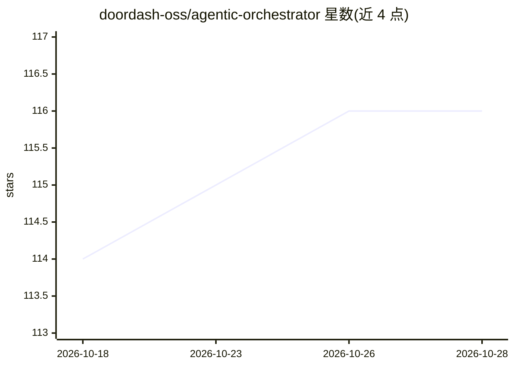

# doordash-oss/agentic-orchestrator

⭐ 117 · Go · Apache-2.0 · 推送 2026-10-28 · [GitHub](https://github.com/doordash-oss/agentic-orchestrator) · 组织维护

**面向工程师的 AI 编码工作流编排器：一个目标变监督式 PR**

DoorDash 开源的桌面应用加 agentico CLI，把高层功能描述转化为包含知识库构建、问询、研究、设计、路线图规划、实现、最终评审到发布的工程工作流。通过 Claude Code、Codex、OpenCode 三类 provider CLI 作为后端（至少装一个），按 Medium/Large/Moonshot 三档深度运行；每个功能在独立 git worktree 中执行，支持多仓库依赖排序与并行运行，人工仅在检查点审批。必需依赖 git 与 gh CLI；桌面版经 Homebrew/Releases 安装，服务器端可用预编译二进制或 Go 源码构建。

## 筛选速览

| 维度 | 判定 | 备注 |
|---|---|---|
| AI 角色 | `ai-ecosystem` | LLM/agent 周边工具 |
| 许可风险 | `permissive` | Apache-2.0 |
| 部署形态 | `library` | 以包/库形式分发 |
| 模型依赖 | locked-api |  |
| 硬件要求 | — | 无带数字的原话,不猜 |
| 安装摩擦 | `medium` | 含编译或系统依赖之一 |
| 成熟度 | — | 结构信号不足 |

## 能力要点

- 单一功能描述驱动的完整生命周期：KB→问询→研究→设计→规划→实现→评审→发布 PR
- Claude Code / Codex / OpenCode 三 provider 平等接入，可按阶段覆盖模型并运行时切换
- 每功能独立 git worktree，支持多仓库依赖排序与并行工作流
- Medium/Large/Moonshot 三档流水线深度与可选人工审批检查点

## 适用场景

- 把一个高层功能描述交给编排器，监督检查点后获得可评审的 PR
- 并行推进多个复杂功能工作流而不污染主工作副本
- 跨多仓库的功能拆分、实现与 PR 交叉关联

## 场景标签

`编码 Agent` · 领域:编码与开发

## 证据(README 行号)

> L5: Agentic Orchestrator is an AI development workflow orchestrator that turns any engineer into a force multiplier. Des
> L20: - **Provider orchestration is explicit** — One provider is enough to run the whole workflow; add more to split the 
> L78: Agentic Orchestrator needs **at least one** AI provider CLI.

## 星数曲线

2026-10-18 114 → 2026-10-28 116（+2）

---
*卡片 v1 · prompt 1.4 · 生成 2026-10-23 · 置信度 mid · 依据 README sha `e3f8ef5c0b33` · [字段定义](../../DATASET.md)*
