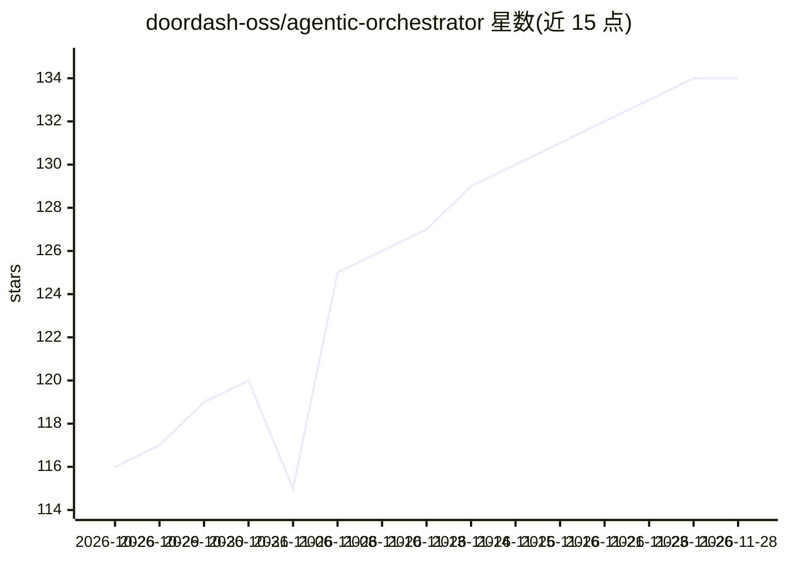

# doordash-oss/agentic-orchestrator

⭐ 134 · Go · Apache-2.0 · 推送 2026-11-27 · [GitHub](https://github.com/doordash-oss/agentic-orchestrator) · 组织维护

**把功能需求变成受监督 AI 编码工作流的编排器**

DoorDash 开源的 AI 开发工作流编排器，以桌面应用为主界面、本地服务器与 CLI `agentico` 配套。它把一条功能描述转化为完整的工程流程：上下文调研、设计、路线图分解、分阶段实现、验证、Final Review 与发布 PR，每个功能在隔离的 worktree/分支/会话中运行，可并行执行多个工作流。运行需至少一个 AI provider CLI（Claude Code、Codex、OpenCode），支持按阶段配置模型与运行时切换，可选人工检查点供决策审批。

## 筛选速览

| 维度 | 判定 | 备注 |
|---|---|---|
| AI 角色 | `ai-ecosystem` | LLM/agent 周边工具 |
| 许可风险 | `permissive` | Apache-2.0 |
| 部署形态 | `library` | 以包/库形式分发 |
| 模型依赖 | — | README 未给出锁定关系 |
| 硬件要求 | — | 无带数字的原话,不猜 |
| 安装摩擦 | `medium` | 含编译或系统依赖之一 |
| 成熟度 | — | 结构信号不足 |

## 能力要点

- 功能生命周期：Inquire/Research/Design → 路线图分阶段实现 → Final Review → 发布
- 每功能隔离 worktree/分支/会话，支持并行多工作流
- 按阶段配置模型推荐，可运行时切换与覆盖 provider
- 三档流水线深度（Medium/Large/Moonshot）与可选人工审批门

## 适用场景

- 把大型功能需求一次性交给 AI 完成从调研到 PR 的全流程
- 在检查点把控关键决策、其余步骤由编排器推进
- 并行监督多个隔离的功能开发工作流

## 场景标签

`编码 Agent` · 领域:编码与开发

## 证据(README 行号)

> L5: Agentic Orchestrator is an AI development workflow orchestrator that turns any engineer into a force multiplier. Des
> L20: - **Provider orchestration is explicit** — One provider is enough to run the whole workflow; add more to split the 
> L78: Agentic Orchestrator needs **at least one** AI provider CLI.

## 星数曲线

2026-10-26 116 → 2026-11-28 134（+18）

---
*卡片 v1 · prompt 1.4 · 生成 2026-11-28 · 置信度 mid · 依据 README sha `eaba041c15c1` · [字段定义](../../DATASET.md)*
