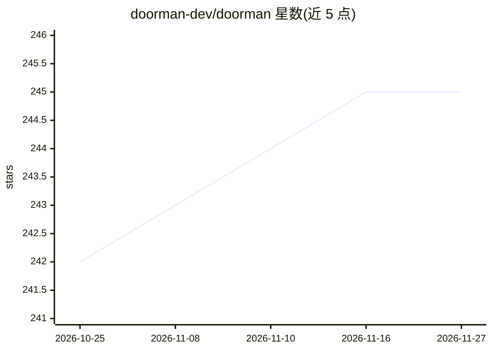

# doorman-dev/doorman

⭐ 245 · Rust · Apache-2.0 · 推送 2026-11-26 · [GitHub](https://github.com/doorman-dev/doorman) · [官网](https://doorman.dev) · 组织维护

**给企业团队用的自托管 AI 与 API 网关**

用 Rust 编写的单一容器网关，同时承担两类职责：AI 网关侧聚合 OpenAI、Anthropic、Gemini、Azure OpenAI 及 OpenAI 兼容模型到统一端点，为员工发放个人 dk_ 密钥、按美元/Token/请求数设置配额，并提供故障切换备用供应商与提示词敏感数据脱敏；API 网关侧将 REST、SOAP、GraphQL、gRPC 纳入统一策略，支持限流、熔断、配额与订阅管理。支持内存模式单节点运行，或多实例时使用 MongoDB 与 Redis 共享状态。Apache 2.0 许可，可自托管。

## 筛选速览

| 维度 | 判定 | 备注 |
|---|---|---|
| AI 角色 | `ai-ecosystem` | LLM/agent 周边工具 |
| 许可风险 | `permissive` | Apache-2.0 |
| 部署形态 | `self-host` | docker 或自建部署 |
| 模型依赖 | locked-api |  |
| 硬件要求 | — | 无带数字的原话,不猜 |
| 安装摩擦 | `low` | 无编译、无系统依赖或容器化 |
| 成熟度 | — | 结构信号不足 |

## 能力要点

- 统一端点接入 OpenAI/Anthropic/Gemini/Azure OpenAI 及 OpenAI 兼容模型
- 按人/组/层级/API 设置美元、Token 或请求数配额
- 提示词与响应中的机密与个人数据脱敏护栏
- 单容器运行，内存模式无需外部依赖，多实例用 MongoDB+Redis

## 适用场景

- 企业为员工统一发放 AI 访问密钥并控制用量
- 在自有基础设施中记录并审计全部 AI 与 API 调用支出
- 将多个 REST/GraphQL/gRPC API 纳入统一策略管理

## 场景标签

`模型网关` · 领域:Agent 开发

## 证据(README 行号)

> L8: ### One gateway for your team's AI and APIs.
> L19: **AI gateway**
> L30: - REST, SOAP, GraphQL, native gRPC and gRPC-Web behind one set of policies

## 星数曲线

2026-10-25 242 → 2026-11-27 245（+3）

---
*卡片 v1 · prompt 1.4 · 生成 2026-11-25 · 置信度 high · 依据 README sha `3b4884fbf7d7` · [字段定义](../../DATASET.md)*
