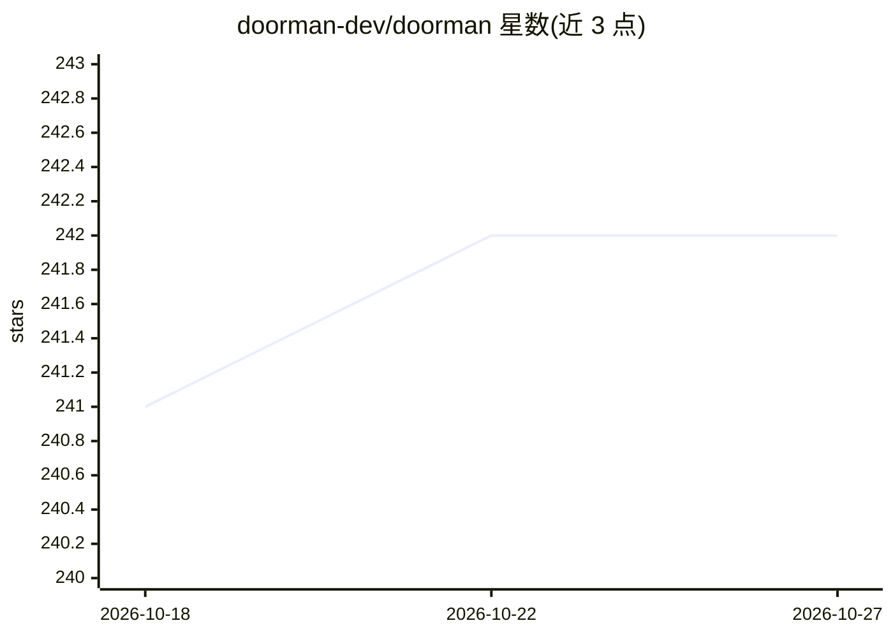

# doorman-dev/doorman

⭐ 242 · Rust · Apache-2.0 · 推送 2026-10-18 · [GitHub](https://github.com/doorman-dev/doorman) · [官网](https://doorman.dev) · 组织维护

**Rust 编写的多协议 API 网关与控制平面，含 AI API 接入**

用 Rust 实现的自托管 API 网关与控制平面，支持 REST、SOAP、GraphQL、gRPC、gRPC-Web 及 AI API 流量。内置控制平面集中管理 API 生命周期、认证与用户、订阅/额度/配额、路由、限流、熔断与监控，附带 Next.js 管理界面。存储支持内存模式或 MongoDB+Redis 共享模式，通过 Docker Compose 启动；多实例部署需切换到 REDIS profile。Apache 2.0 许可，由 Doorman Dev, LLC 维护。

## 筛选速览

| 维度 | 判定 | 备注 |
|---|---|---|
| AI 角色 | `ai-ecosystem` | LLM/agent 周边工具 |
| 许可风险 | `permissive` | Apache-2.0 |
| 部署形态 | `self-host` | docker 或自建部署 |
| 模型依赖 | — | README 未给出锁定关系 |
| 硬件要求 | — | 无带数字的原话,不猜 |
| 安装摩擦 | `low` | 无编译、无系统依赖或容器化 |
| 成熟度 | — | 结构信号不足 |

## 能力要点

- 多协议网关：REST、SOAP、GraphQL、gRPC、gRPC-Web 及 AI API
- 内置控制平面：认证、用户、API 目录、订阅、额度、配额、监控
- 内存模式无需外部依赖，共享模式用 MongoDB+Redis
- Next.js 管理界面随 Rust 服务一同部署

## 适用场景

- 自托管统一网关管理多协议 API 的路由、限流与安全
- 对 API（含 AI API）做版本生命周期与配额管理
- 用内置控制平面管理用户、角色与订阅

## 场景标签

`模型网关` · 领域:Agent 开发

## 证据(README 行号)

> L11: A Rust API gateway and control plane for REST, SOAP, GraphQL, gRPC, gRPC-Web, and AI APIs.
> L19: - Native control plane: authentication, users, APIs, endpoints, roles, groups, routing, subscriptions, credits, tie

## 星数曲线

2026-10-18 241 → 2026-10-27 242（+1）

---
*卡片 v1 · prompt 1.4 · 生成 2026-10-22 · 置信度 high · 依据 README sha `b15da077bb47` · [字段定义](../../DATASET.md)*
