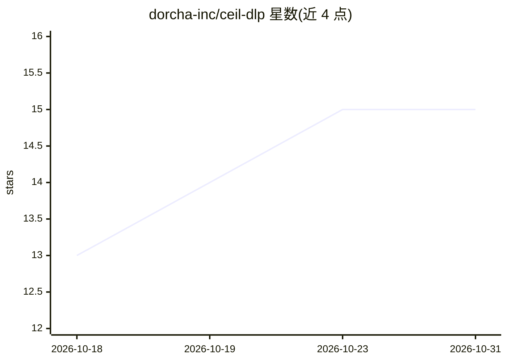

# dorcha-inc/ceil-dlp

⭐ 15 · Python · MIT · 推送 2026-01-20 · [GitHub](https://github.com/dorcha-inc/ceil-dlp) · 组织维护

**LiteLLM 的开源 DLP 插件：LLM 请求中的 PII/密钥检测与防护**

面向 LiteLLM 的数据防泄漏（DLP）回调插件：在请求到达 LLM 供应商前检测文本、图像与 PDF 中的 PII/PHI 及密钥，执行阻断、掩码或可逆令牌（whistledown）处理，后者在响应中还原原值以保持对话连贯。通过 CLI 自动写入 LiteLLM 配置，支持按模型配置不同策略（如外部供应商阻断、本地模型放行）。检测采用 NER 集成（spaCy/BERT/GLiNER 三档强度）与多引擎 OCR 集成。限制：依赖 LiteLLM 回调体系运行。

## 筛选速览

| 维度 | 判定 | 备注 |
|---|---|---|
| AI 角色 | `ai-ecosystem` | LLM/agent 周边工具 |
| 许可风险 | `permissive` | MIT |
| 部署形态 | `library` | 以包/库形式分发 |
| 模型依赖 | — | README 未给出锁定关系 |
| 硬件要求 | — | 无带数字的原话,不猜 |
| 安装摩擦 | `low` | 无编译、无系统依赖或容器化 |
| 成熟度 | — | 结构信号不足 |

## 能力要点

- 文本、图像、PDF 中的 PII/PHI 与密钥统一检测（NER 集成 + 多引擎 OCR 集成，各三档强度）
- whistledown 模式用一致可逆令牌掩码并在响应中自动还原，保持对话连贯
- 按模型配置差异策略：外部供应商阻断、本地模型放行，regex 即可定义
- CLI 一条命令自动接入/移除 LiteLLM 配置

## 适用场景

- 我的 LLM 网关要防止用户输入中的敏感信息外发给外部模型供应商
- HIPAA/PCI-DSS/GDPR/CCPA 合规场景下的对话数据脱敏
- 希望脱敏后对话仍自然可读，而非满屏 [REDACTED]

## 场景标签

`网络安全` · 领域:学习与行业

## 证据(README 行号)

> L11: `ceil-dlp` is a Data Loss Prevention (DLP) plugin for LiteLLM that automatically detects and protects Personally Id
> L66: `ceil-dlp` provides image and PDF support, detecting both PII and secrets in images + pdfs through OCR,. It applies

## 星数曲线

2026-10-18 13 → 2026-10-31 15（+2）

---
*卡片 v1 · prompt 1.4 · 生成 2026-10-31 · 置信度 high · 依据 README sha `620d12cdbb82` · [字段定义](../../DATASET.md)*
