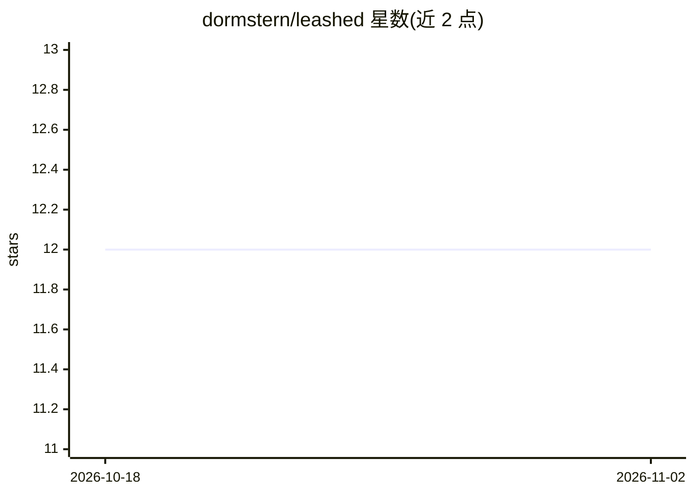

# dormstern/leashed

⭐ 12 · TypeScript · MIT · 推送 2026-02-23 · [GitHub](https://github.com/dormstern/leashed) · [官网](https://behalf.work/harness/) · 个人维护

**给 AI agent 的策略、审计与急停层：管控其账户操作**

面向拥有账户访问权的 AI agent 的应用层授权工具：用 leash.yaml 定义 allow/deny 规则，以 deny-first 模式匹配门控任务，执行时间与动作数预算控制，全部请求（放行与拦截）写入 JSONL 审计日志，提供 yank() 即时销毁云浏览器会话的 kill switch。凭据隔离在 AnchorBrowser 隔离云浏览器中，agent 只获得预认证会话。以 npm 包与 npx CLI 提供，限制：不做浏览器动作级校验与语义等价判断，对抗性 agent 可绕过模式匹配（README 自述）。

## 筛选速览

| 维度 | 判定 | 备注 |
|---|---|---|
| AI 角色 | `ai-ecosystem` | LLM/agent 周边工具 |
| 许可风险 | `permissive` | MIT |
| 部署形态 | `library` | 以包/库形式分发 |
| 模型依赖 | — | README 未给出锁定关系 |
| 硬件要求 | — | 无带数字的原话,不猜 |
| 安装摩擦 | `low` | 无编译、无系统依赖或容器化 |
| 成熟度 | — | 结构信号不足 |

## 能力要点

- deny-first 模式匹配任务门控 + Unicode 绕过防护（零宽字符/BiDi 控制符）
- 全部任务请求记录 JSONL 审计日志
- yank() 一键销毁云浏览器会话的 kill switch
- 时间与动作数预算控制，凭据不直接交给 agent

## 适用场景

- 给接入自己账户的 agent 加策略与急停开关
- 审计 agent 的全部操作（放行与拦截均留痕）
- 用隔离云浏览器避免把密码交给 agent

## 场景标签

`网络安全` · 领域:学习与行业

## 证据(README 行号)

> L5: Policy, audit, kill switch for any AI agent with access to your accounts.
> L60: leashed is **application-layer authz for AI agents** — it governs what agents are *authorized to do*, not who they 

## 星数曲线

2026-10-18 12 → 2026-11-02 12（+0）

---
*卡片 v1 · prompt 1.4 · 生成 2026-11-01 · 置信度 high · 依据 README sha `dd066568ea8f` · [字段定义](../../DATASET.md)*
