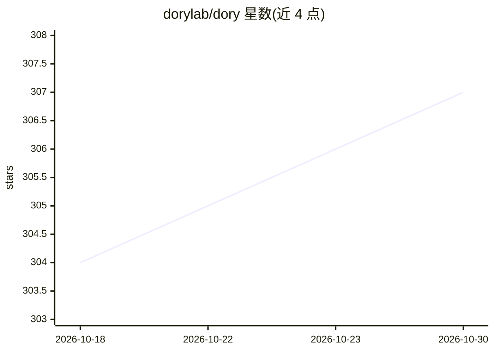

# dorylab/dory

⭐ 307 · TypeScript · Apache-2.0 · 推送 2026-10-29 · [GitHub](https://github.com/dorylab/dory) · [官网](https://getdory.dev) · 组织维护

**面向人类与 AI agent 的 SQL 工作台客户端**

多数据库 SQL 客户端（ClickHouse/PostgreSQL/MySQL/DuckDB/Snowflake 等 12 种），提供多标签 SQL 编辑器、Schema 可视化地图、结果集过滤与图表、保存查询。AI 侧：基于真实 Schema 与查询上下文的 SQL 生成/改写助手（OpenAI/Anthropic/Google/Qwen/xAI 等可切换），并通过 MCP 让 Claude Code、Codex CLI 等 agent 执行只读 SQL，agent 产出转为人类可编辑的工作区。提供 macOS/Windows 桌面安装包、Homebrew、Docker 与 Docker Compose 自托管，另有 @getdory/cli 无头运行时。ClickHouse 有深度集成（查询监控、用户/角色管理）。

## 筛选速览

| 维度 | 判定 | 备注 |
|---|---|---|
| AI 角色 | `ai-enhanced` | 去掉 AI 部分产品仍成立 |
| 许可风险 | `permissive` | Apache-2.0 |
| 部署形态 | `self-host` | docker 或自建部署 |
| 模型依赖 | locked-api |  |
| 硬件要求 | — | 无带数字的原话,不猜 |
| 安装摩擦 | `low` | 无编译、无系统依赖或容器化 |
| 成熟度 | — | 结构信号不足 |

## 能力要点

- 支持 12 种数据库，ClickHouse 深度集成（查询监控、角色管理、集群权限）
- agent 通过 MCP 生成的 SQL 标签页/结果集/图表可被人类继续编辑
- 可切换 AI provider（OpenAI/Anthropic/Google/Qwen/xAI），改环境变量即生效
- 交互式 Schema 关系图，可导出 PNG/SVG

## 适用场景

- 日常写 SQL、查数据、做图表的数据分析工作台
- 让 Claude Code/Codex CLI 等 agent 在数据库上执行分析，人工复核其 SQL 与结果
- ClickHouse 团队做查询监控与权限管理
- 自托管部署作为团队的数据库执行层

## 场景标签

`数据分析` · 领域:效率与自动化

## 证据(README 行号)

> L12: **Dory is an AI-native SQL client for humans and agents.**
> L53: - Humans use Dory as a SQL client: write SQL, browse schema, run queries, filter results, create charts, and save q

## 星数曲线

2026-10-18 304 → 2026-10-30 307（+3）

---
*卡片 v1 · prompt 1.4 · 生成 2026-10-21 · 置信度 high · 依据 README sha `c467dc59bd47` · [字段定义](../../DATASET.md)*
