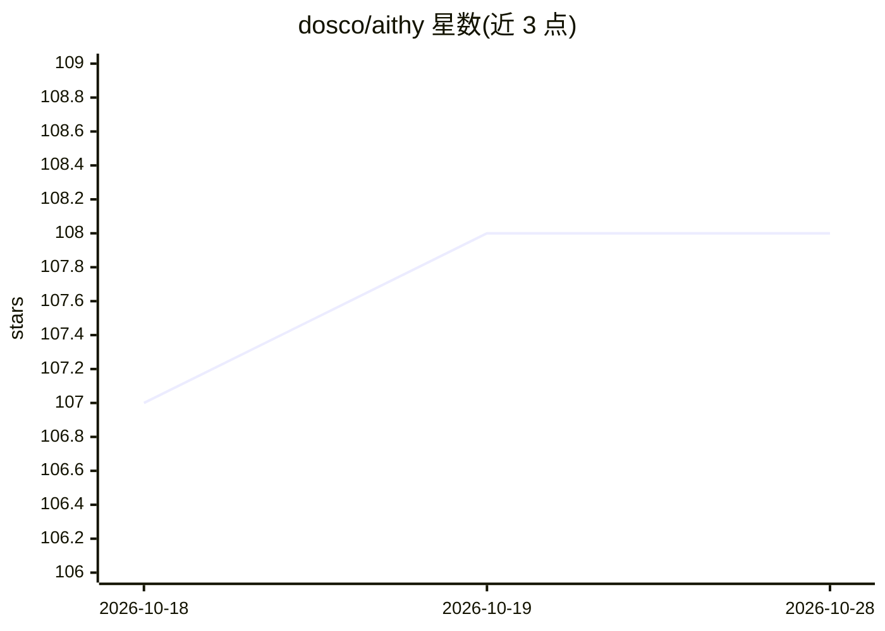

# dosco/aithy

⭐ 108 · TypeScript · Apache-2.0 · 推送 2026-08-31 · [GitHub](https://github.com/dosco/aithy) · [官网](https://aithy.dev) · 个人维护

**本地运行的个人 AI agent 运行时，数据留在本机**

Aithy 是一个在本地启动、通过浏览器控制台使用的个人 AI agent 运行时：支持托管 llama.cpp 本地模型、云/API 提供商（OpenAI Responses、OpenRouter、Groq、Azure 等）、符合资格的 Grok 订阅 OAuth 登录，以及 LAN Mesh 共享家用 GPU 机器的推理/搜索服务。内置持久会话、沙箱工具、检索、记忆、技能、知识与工件库（SQLite 存储），支持 MCP 客户端连接并暴露只读 MCP 端点。提供 darwin-arm64 与 Linux x64/ARM64 打包发布（Intel Mac 与 Windows 尚未发布），也可用 Bun 1.4.0+ 从源码运行。

## 筛选速览

| 维度 | 判定 | 备注 |
|---|---|---|
| AI 角色 | `ai-native` | 本体是模型或模型工具 |
| 许可风险 | `permissive` | Apache-2.0 |
| 部署形态 | `self-host` | docker 或自建部署 |
| 模型依赖 | local-ok | 支持本地模型 |
| 硬件要求 | — | 无带数字的原话,不猜 |
| 安装摩擦 | `low` | 无编译、无系统依赖或容器化 |
| 成熟度 | — | 结构信号不足 |

## 能力要点

- 浏览器可检视的 agent 工作区：会话、记忆、技能、沙箱状态均可见
- 模型源作为运行时选择：本地 llama.cpp、云提供商、Grok 订阅 OAuth、Mesh 共享 GPU
- Knowledge/Memory/Skills/Episodes/Artifacts 分离的 SQLite 数据面，支持 OKF 导入导出
- MCP 客户端接入与只读 MCP 端点，按服务器与工具粒度权限控制

## 适用场景

- 在本机跑一个数据不外流的个人 AI agent
- 笔记本配对家中 GPU 机器共享本地推理
- 把知识与记忆组织成可检索的 agent 资产

## 场景标签

`AI 助手` · 领域:对话与助手

## 证据(README 行号)

> L10: Aithy is a private local AI runtime: easy to run, inspectable in the browser, and ready for local models, cloud pro
> L14: Aithy is useful as a personal agent today, but it is also built for the messy place where agent research becomes re
> L18: - **Run it locally.** Start Aithy, open the browser control surface, and use an inspectable agent workspace without

## 星数曲线

2026-10-18 107 → 2026-10-28 108（+1）

---
*卡片 v1 · prompt 1.4 · 生成 2026-10-23 · 置信度 mid · 依据 README sha `eeb3fb7cbcf9` · [字段定义](../../DATASET.md)*
