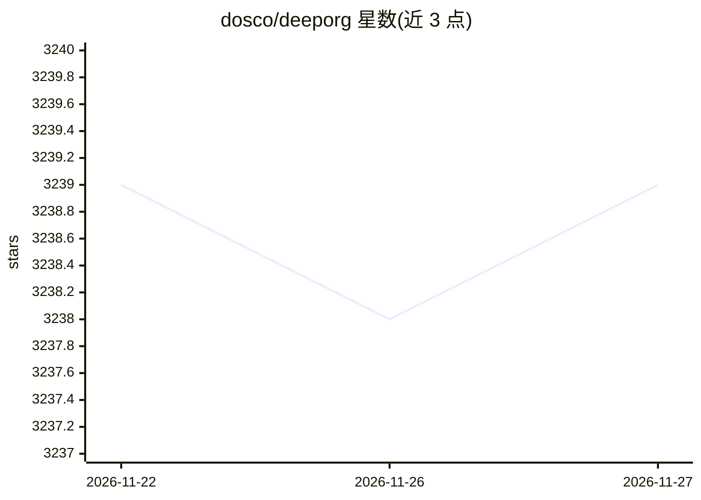

# dosco/deeporg

⭐ 3,239 · Go · Apache-2.0 · 推送 2026-11-26 · [GitHub](https://github.com/dosco/deeporg) · [官网](https://deeporg.io) · 个人维护

**企业级 AI 代理：跨数据库、API、文件与代码回答和执行操作**

前身为 GraphJin 的 AI 代理，用自然语言查询和变更企业已有系统：数据库、数据仓库、API、文件与源码。底层引擎将请求编译为单一数据库查询，并按访问规则校验，默认变更需人工批准。提供基准测试榜单与可从自有系统生成评分任务用于评测或强化学习训练的环境。可通过安装脚本、npm、brew、Windows 包或 Docker 部署，并支持经 MCP 接入 Claude Code 等客户端。

## 筛选速览

| 维度 | 判定 | 备注 |
|---|---|---|
| AI 角色 | `ai-native` | 本体是模型或模型工具 |
| 许可风险 | `permissive` | Apache-2.0 |
| 部署形态 | `desktop` | 安装包/桌面程序 |
| 模型依赖 | — | README 未给出锁定关系 |
| 硬件要求 | — | 无带数字的原话,不猜 |
| 安装摩擦 | `low` | 无编译、无系统依赖或容器化 |
| 成熟度 | — | 结构信号不足 |

## 能力要点

- 无需手工构建工具，自动生成并校验数据库查询
- 访问规则控制可见与可改范围，变更默认等待批准
- 组织基准测试与可用于评测/强化学习的 agent 环境
- 经 MCP 接入 Claude Code 等客户端

## 适用场景

- 用自然语言查询公司数据库与数据仓库并获取答案
- 让代理在访问规则约束下安全地修改企业系统数据
- 在自有企业系统上评测或训练 agent

## 场景标签

`数据分析` `模型评测` `强化学习` · 领域:效率与自动化

## 证据(README 行号)

> L11: DeepORG is an AI agent that answers questions and makes changes across the
> L41: Underneath is GraphJin, the open-source engine that compiles each query into a
> L82: claude mcp add --transport http --scope user deeporg http://127.0.0.1:8080/api/v1/mcp

## 星数曲线

2026-11-22 3,239 → 2026-11-27 3,239（+0）

---
*卡片 v1 · prompt 1.4 · 生成 2026-11-27 · 置信度 high · 依据 README sha `e139c469c34f` · [字段定义](../../DATASET.md)*
