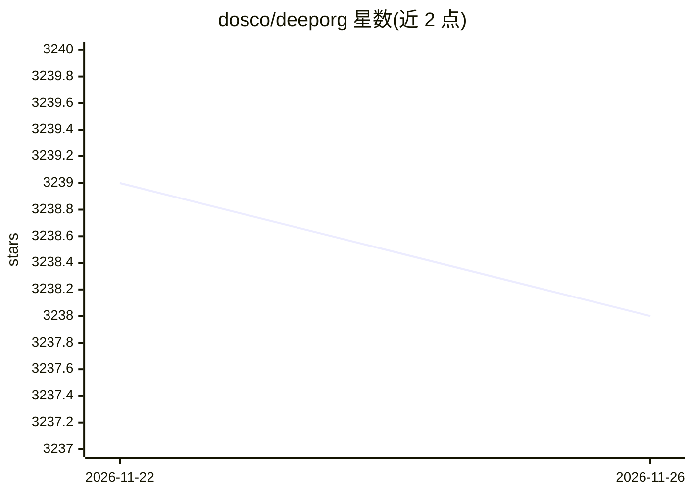

# dosco/deeporg

⭐ 3,238 · Go · Apache-2.0 · 推送 2026-11-25 · [GitHub](https://github.com/dosco/deeporg) · [官网](https://deeporg.io) · 个人维护

**面向企业的组织级 AI agent：统一访问数据库、API、文件与代码**

DeepORG（原 GraphJin）是一个 AI agent，用自然语言提问即可查询并修改企业已有系统：数据库、数据仓库、API、文件与源码。机制上不为每个任务手写工具，而是为 agent 提供所连接系统的可检索地图，由 agent 自行生成查询，引擎将其编译为单条数据库查询并按用户访问规则校验执行；变更默认需用户批准。底层是开源引擎 GraphJin，也可作为 GraphQL API 服务器与 Go 库使用；提供 benchmark 与 RL 训练环境，通过 MCP 与 Claude 等 client 集成。

## 筛选速览

| 维度 | 判定 | 备注 |
|---|---|---|
| AI 角色 | `ai-native` | 本体是模型或模型工具 |
| 许可风险 | `permissive` | Apache-2.0 |
| 部署形态 | `desktop` | 安装包/桌面程序 |
| 模型依赖 | — | README 未给出锁定关系 |
| 硬件要求 | — | 无带数字的原话,不猜 |
| 安装摩擦 | `low` | 无编译、无系统依赖或容器化 |
| 成熟度 | `idea` | |

## 能力要点

- 无需手写工具：为 agent 提供连接系统的可检索地图，agent 自行生成查询
- 查询经访问规则校验后编译为单条高效数据库查询，变更默认等待批准
- 提供组织级 agent benchmark 及可生成评分任务的训练环境（支持 RL）
- 以 MCP 服务器形式供 Claude、Codex 等客户端调用

## 适用场景

- 用自然语言查询公司数据库、仓库、API 与文件并获得带数据的回答
- 把已有业务系统接入 MCP，供 Claude/Codex 等 agent 客户端使用
- 在自己组织的数据上评测或通过强化学习训练 agent

## 场景标签

`数据分析` `模型评测` `强化学习` · 领域:效率与自动化

## 证据(README 行号)

> L11: DeepORG is an AI agent that answers questions and makes changes across the
> L41: Underneath is GraphJin, the open-source engine that compiles each query into a
> L43: own right.

## 星数曲线

2026-11-22 3,239 → 2026-11-26 3,238（-1）

---
*卡片 v1 · prompt 1.4 · 生成 2026-11-24 · 置信度 high · 依据 README sha `b2af60363b9b` · [字段定义](../../DATASET.md)*
