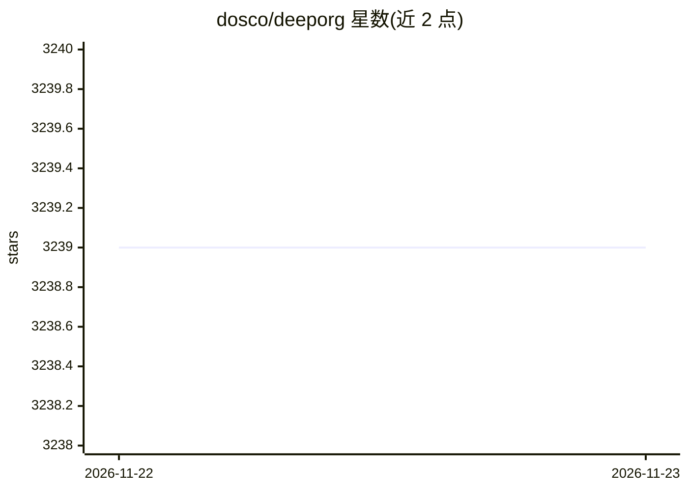

# dosco/deeporg

⭐ 3,239 · Go · Apache-2.0 · 推送 2026-11-22 · [GitHub](https://github.com/dosco/deeporg) · [官网](https://deeporg.io) · 个人维护

**企业组织的 AI agent：用自然语言查询并操作数据库、API、文件与代码**

DeepORG（前身为 GraphJin）是一个面向企业内部系统的 AI agent：用户以自然语言提问，agent 通过可搜索的连接系统地图自行生成查询，由底层 GraphJin 引擎编译为单条数据库查询执行，并按访问规则校验，变更操作默认等待用户批准。可通过 MCP 被 Claude 等客户端调用，附带组织级 agent 基准测试与可生成训练任务的环境。安装提供 shell 脚本、npm、brew、Docker 与 Windows 压缩包。

## 筛选速览

| 维度 | 判定 | 备注 |
|---|---|---|
| AI 角色 | `ai-native` | 本体是模型或模型工具 |
| 许可风险 | `permissive` | Apache-2.0 |
| 部署形态 | `desktop` | 安装包/桌面程序 |
| 模型依赖 | — | README 未给出锁定关系 |
| 硬件要求 | — | 无带数字的原话,不猜 |
| 安装摩擦 | `low` | 无编译、无系统依赖或容器化 |
| 成熟度 | — | 结构信号不足 |

## 能力要点

- agent 自行编写查询，无需逐个手工构建工具
- 查询经访问规则校验，变更默认等待用户批准
- 底层 GraphJin 引擎将查询编译为单条数据库查询，亦可独立作为 GraphQL 服务器与 Go 库
- 支持 MCP 协议接入 Claude、Codex 等客户端

## 适用场景

- 用自然语言查询公司数据库、数仓与 API 中的数据
- 经 MCP 在 Claude/Codex 客户端中调用组织内部数据
- 用组织自身系统生成任务评测或训练 agent

## 场景标签

`数据分析` `模型评测` · 领域:效率与自动化

## 证据(README 行号)

> L11: DeepORG is an AI agent that answers questions and makes changes across the
> L13: source code. Ask it in plain words; it finds the right tables, has the database

## 星数曲线

2026-11-22 3,239 → 2026-11-23 3,239（+0）

---
*卡片 v1 · prompt 1.4 · 生成 2026-11-22 · 置信度 high · 依据 README sha `99ffdf4fde49` · [字段定义](../../DATASET.md)*
