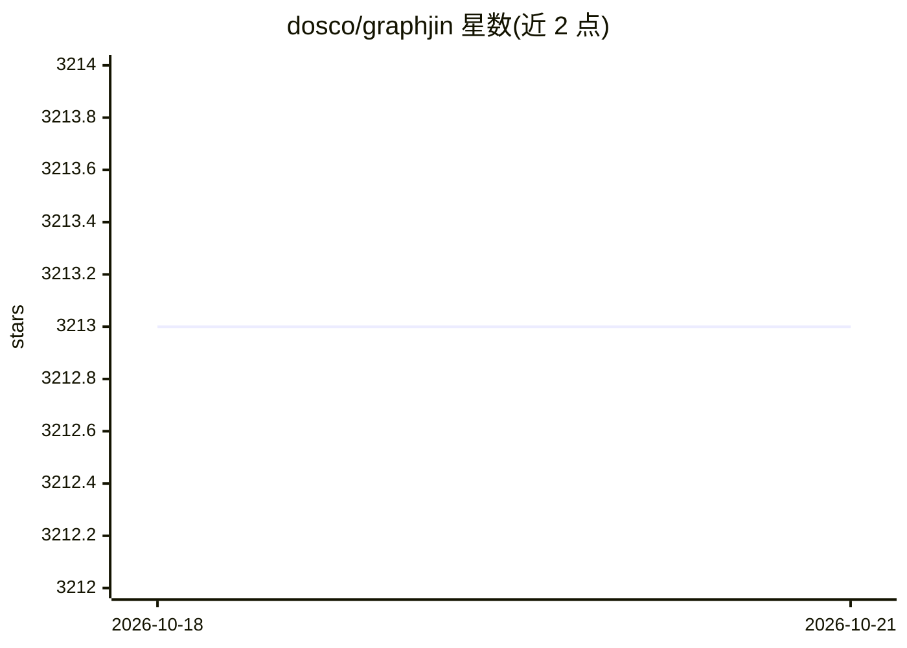

# dosco/graphjin

⭐ — · [GitHub]() · 个人维护

**面向 AI agent 的统一受治数据图：GraphQL+MCP 接入数据库与代码**

Go 实现的编译器与运行时：把 PostgreSQL、MySQL、MongoDB、Snowflake、S3 文件、源码索引等企业既有系统暴露为一个受治理的 GraphQL + MCP 图，agent 先经 query_catalog 发现元数据、再在允许列表/只读边界/策略约束下执行操作，回答经执行台账核验后返回。同时保留 GraphQL-to-database 编译器、独立 API 服务、REST/OpenAPI 网关与订阅服务能力。内置 server-side agent（需 OPENAI/ANTHROPIC/GOOGLE API key）、gj_watch 持久订阅与 JS 工作流。提供 npm/brew/scoop/deb/rpm/Docker 安装。

## 筛选速览

| 维度 | 判定 | 备注 |
|---|---|---|
| AI 角色 | `ai-ecosystem` | LLM/agent 周边工具 |
| 许可风险 | `permissive` | — |
| 部署形态 | `desktop` | 安装包/桌面程序 |
| 模型依赖 | — | README 未给出锁定关系 |
| 硬件要求 | — | 无带数字的原话,不猜 |
| 安装摩擦 | `low` | 无编译、无系统依赖或容器化 |
| 成熟度 | — | 结构信号不足 |

## 能力要点

- 单一 MCP+GraphQL 接口覆盖多种数据库、仓库、对象存储与 CodeSQL 源码索引
- 发现-校验-执行-观测的受治 agent 流程：查询允许列表、只读边界、执行台账
- 内置 server-side agent 与 gj_watch 持久订阅（评估走数据库轮询而非模型调用）
- 同时是 GraphQL-to-database 编译器、REST/OpenAPI 网关与实时订阅服务

## 适用场景

- 让 Claude/Codex 等 MCP 客户端安全查询公司数据库而不交出原始凭据
- 把现有数据库与源码统一暴露给 AI agent 做发现与受控操作
- 作为 GraphQL API 服务替代手写 resolver/ORM 层

## 场景标签

 · 领域:数据库/API 基础设施

## 证据(README 行号)

> L10: GraphJin is a compiler and runtime that gives AI agents one governed graph over the systems a real company already 
> L12: It is not only for agents. GraphJin is still a high-performance GraphQL-to-database compiler, Go library, standalon
> L122: ## Add GraphJin To Your AI Client

## 星数曲线

2026-10-18 3,213 → 2026-10-21 3,213（+0）

---
*卡片 v1 · prompt 1.4 · 生成 2026-10-20 · 置信度 high · 依据 README sha `6b83adf75b58` · [字段定义](../../DATASET.md)*
