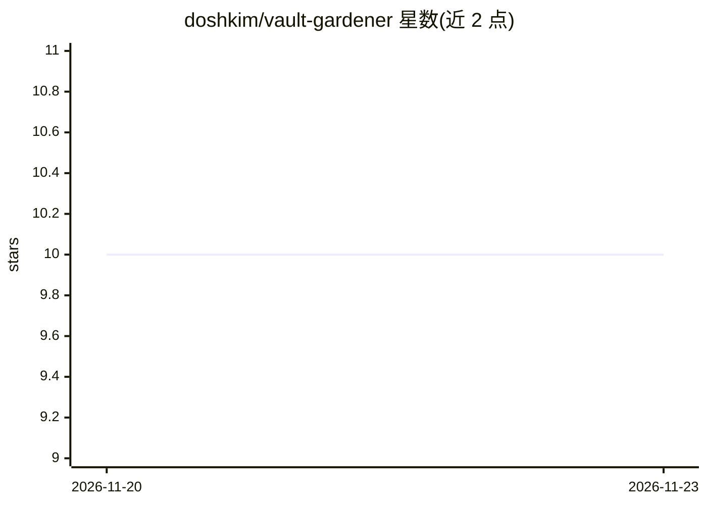

# doshkim/vault-gardener

⭐ 10 · TypeScript · MIT · 推送 2026-04-12 · [GitHub](https://github.com/doshkim/vault-gardener) · 个人维护

**面向 markdown 知识库的 AI 自动维护流水线**

npm 分发的 CLI 工具，指向任意 .md 文件夹（含 Obsidian/Logseq 等），通过委托用户已安装的 AI CLI（Claude Code、Codex CLI 或 Gemini CLI）执行三阶段维护：Seed 收件箱分诊路由、Nurture 结构修复与链接构建、Tend 生命周期管理与期刊汇总，共 23 个可独立开关的功能。不删除笔记，提供 dry-run、批处理上限、受保护路径等安全机制；认证直接使用各 provider 的 API key，工具会在传给模型前剥离密钥。

## 筛选速览

| 维度 | 判定 | 备注 |
|---|---|---|
| AI 角色 | `ai-native` | 本体是模型或模型工具 |
| 许可风险 | `permissive` | MIT |
| 部署形态 | `library` | 以包/库形式分发 |
| 模型依赖 | locked-api |  |
| 硬件要求 | — | 无带数字的原话,不猜 |
| 安装摩擦 | `low` | 无编译、无系统依赖或容器化 |
| 成熟度 | — | 结构信号不足 |

## 能力要点

- 三阶段流水线（Seed → Nurture → Tend），23 个功能默认开启且可独立配置
- 支持 Claude/Codex/Gemini 三种 AI CLI，各有 power/fast 两档模型档位
- 安全机制：绝不删除笔记、dry-run 模式、批处理上限、受保护路径
- 自动生成周/月/季/年期刊汇总，支持结构化与叙事两种风格

## 适用场景

- 清理 Obsidian 仓库积压的收件箱笔记并自动归类
- 修复知识库中的孤立笔记、同义标签和缺失链接
- 从每日笔记自动生成周报月报与目标进度追踪

## 场景标签

`知识库管理` · 领域:知识与检索

## 证据(README 行号)

> L9: **vault-gardener** is an AI-powered maintenance pipeline for your markdown knowledge base. Point it at your vault, p
> L88: vault-gardener delegates to an AI coding agent that reads your vault, understands its structure, and performs the m
> L119: vault-gardener delegates to your chosen CLI tool — you authenticate with the provider directly, not with vault-gar

## 星数曲线

2026-11-20 10 → 2026-11-23 10（+0）

---
*卡片 v1 · prompt 1.4 · 生成 2026-11-20 · 置信度 high · 依据 README sha `aa48fed0edab` · [字段定义](../../DATASET.md)*
