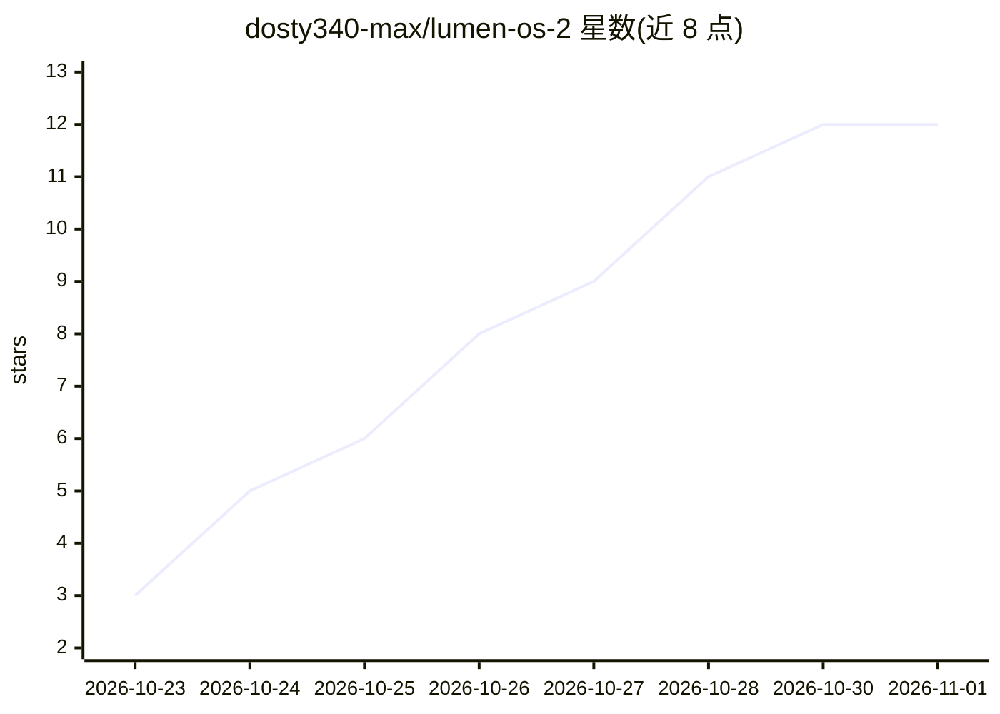

# dosty340-max/lumen-os-2

⭐ 12 · C · MIT · 推送 2026-10-16 · [GitHub](https://github.com/dosty340-max/lumen-os-2) · [官网](https://youtu.be/ANYIBMva0wI) · 个人维护

**由 Claude Code 从零编写的手机操作系统，含自研浏览器与 YouTube 播放器**

运行于 Linux 内核之上的手机 OS：用户态（Slab UI、合成器、8 个应用）为单一 C 程序（PID 1），自研 DHCP/DNS/HTTP 客户端、HTML/CSS 浏览器（无 JS 引擎）、YouTube 播放（借 Mac 端 ytbridge.py + yt-dlp/ffmpeg 转码，手机端自行解码）。给操作系统/图形/网络学习者与极客演示。需 Apple Silicon Mac + Docker + QEMU，首次构建约 3 分钟，VNC 交互。代码由 Claude Code 约 2 小时生成，自带 32 项端到端检查。

## 筛选速览

| 维度 | 判定 | 备注 |
|---|---|---|
| AI 角色 | `ai-enhanced` | 去掉 AI 部分产品仍成立 |
| 许可风险 | `permissive` | MIT |
| 部署形态 | `None` |  |
| 模型依赖 | — | README 未给出锁定关系 |
| 硬件要求 | — | 无带数字的原话,不猜 |
| 安装摩擦 | `medium` | 含编译或系统依赖之一 |
| 成熟度 | — | 结构信号不足 |

## 能力要点

- 自研软件光栅化合成器，60 fps 渲染
- 自实现 DHCP/DNS/HTTP/HTTPS(BearSSL) 网络栈
- HTML/CSS 浏览器可渲染 Wikipedia、Hacker News，无 JavaScript 引擎
- YouTube 播放：手机端逐帧解码，30 fps、0 丢帧（316 秒浸泡测试）

## 适用场景

- 在 QEMU 中体验从零构建的手机操作系统
- 学习软件渲染、合成器与用户态网络栈的实现
- 观看 AI（Claude Code）自动编写完整 OS 的工程案例

## 场景标签

 · 领域:操作系统/系统编程

## 证据(README 行号)

> L1: Lumen OS 2: a phone OS written from scratch by Claude
> L9:  No Android. No iOS. No UI toolkit. No browser engine. Just a Linux kernel, and everything above it written by Claud
> L109: |Build time|about **2 hours** of Claude Code, from an empty folder (`PROGRESS.log`)|

## 星数曲线

2026-10-23 3 → 2026-11-01 12（+9）

---
*卡片 v1 · prompt 1.4 · 生成 2026-11-01 · 置信度 mid · 依据 README sha `f6f5152ebb4e` · [字段定义](../../DATASET.md)*
