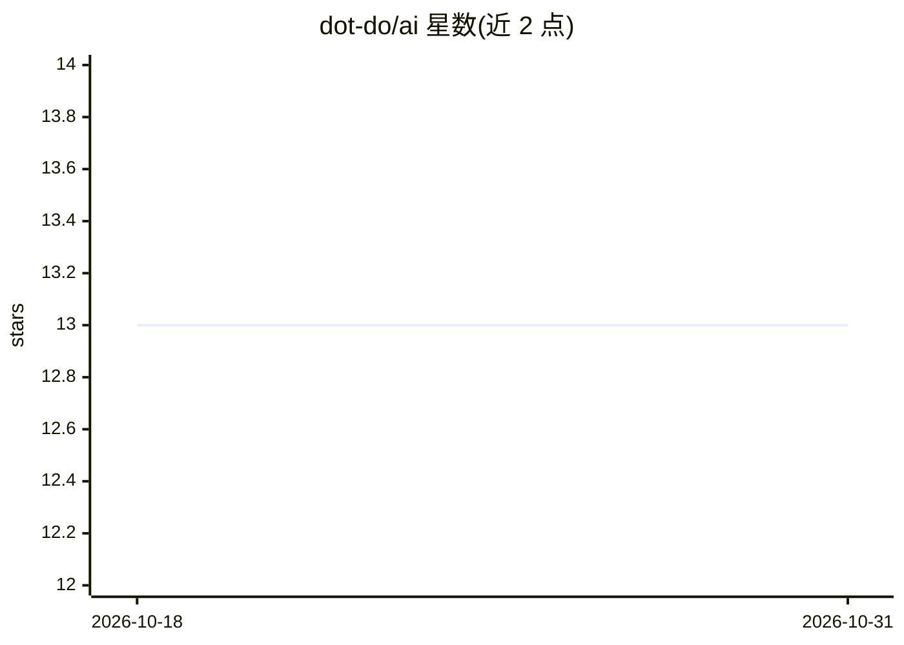

# dot-do/ai

⭐ 13 · TypeScript · 推送 2026-10-26 · [GitHub](https://github.com/dot-do/ai) · [官网](https://platform.do) · 组织维护

**面向 Business-as-Code 的语义化 TypeScript SDK 与 AI 工具集**

提供 sdk.do、cli.do、mcp.do 及 REST API 四种协议入口，统一以 $.Subject.predicate.Object 语义函数表达数据库操作、AI 生成、事件与工作流。附带 18+ 个语义数据包（Schema.org 800+ 类型、GS1 供应链、O*NET 职业数据、NAICS/APQC 等，多为 CC-BY-4.0），支持 MDX/Markdown 作为语义数据库、语义事件监听与定时工作流，并可将 SDK 暴露为 MCP 服务器供 AI 助手调用。以 pnpm/npm 安装 TypeScript 包方式提供给开发者。

## 筛选速览

| 维度 | 判定 | 备注 |
|---|---|---|
| AI 角色 | `ai-ecosystem` | LLM/agent 周边工具 |
| 许可风险 | `none` | — |
| 部署形态 | `library` | 以包/库形式分发 |
| 模型依赖 | — | README 未给出锁定关系 |
| 硬件要求 | — | 无带数字的原话,不猜 |
| 安装摩擦 | `low` | 无编译、无系统依赖或容器化 |
| 成熟度 | — | 结构信号不足 |

## 能力要点

- SDK/CLI/MCP/REST 四协议共享同一套语义函数
- 18+ 个语义数据包（Schema.org、GS1、O*NET、NAICS 等）
- MDX/Markdown 文件可作语义数据库查询管理
- mcp.do 可将 SDK 暴露为 MCP 服务器

## 适用场景

- 用语义模式表达业务事件、流程与数据操作
- 为 AI 助手提供 MCP 接口访问业务语义函数
- 复用职业、供应链、行业分类等结构化语义数据包

## 场景标签

`工作流自动化` · 领域:效率与自动化

## 证据(README 行号)

> L3: Open-source SDKs, packages, and tools for building autonomous Business-as-Code with semantic intent.
> L22: - **AI-Native**: Generate content with semantic schemas and batch processing
> L180: ### `ai` - AI Services

## 星数曲线

2026-10-18 13 → 2026-10-31 13（+0）

---
*卡片 v1 · prompt 1.4 · 生成 2026-10-31 · 置信度 high · 依据 README sha `c5db70c1674f` · [字段定义](../../DATASET.md)*
