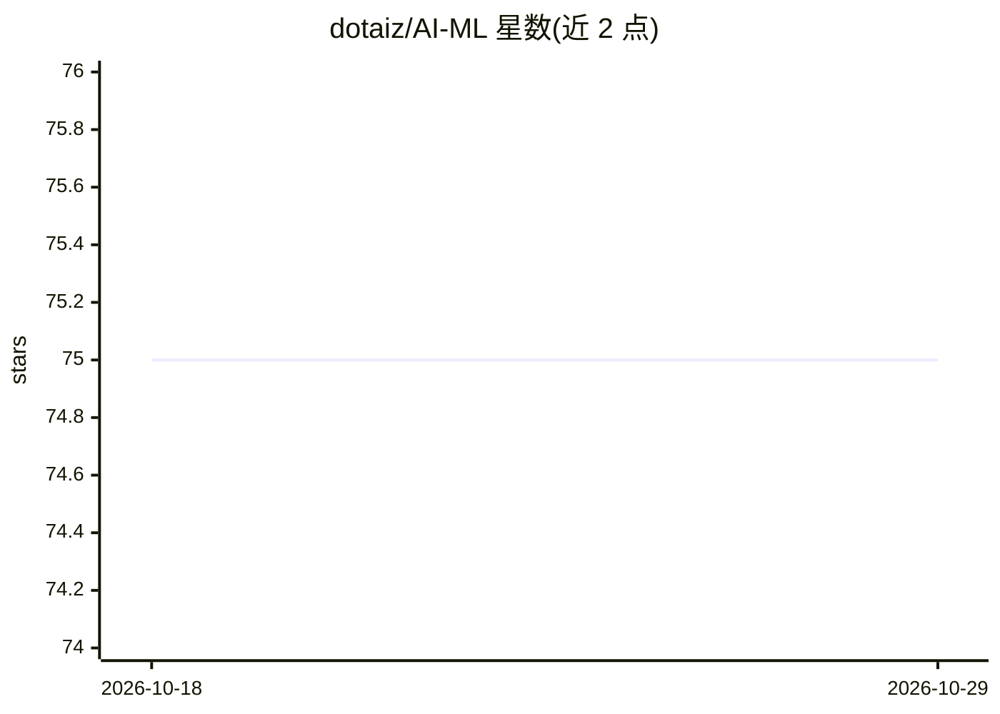

# dotaiz/AI-ML

⭐ 75 · Jupyter Notebook · 推送 2026-09-28 · [GitHub](https://github.com/dotaiz/AI-ML) · [官网](https://www.dotaiz.com) · 个人维护

**AI/ML 与生成式 AI 的实战 notebook 与学习资源策展库**

个人维护的动手学习库，收录可复现的 notebook 与指南，覆盖 AI/ML 基础、LangChain/LangGraph、LlamaIndex、多种 RAG 变体（混合检索、GraphRAG、CRAG、多模态）、Agent 与编排（PydanticAI、CrewAI、DSPy）、MCP、可观测性，以及 GenAI 面试题库。另附两个独立 PyPI 包（InstructVault、非凸优化基准函数库）、外部学习资源与 agent skills 清单。面向通过实践学习 AI/ML 的开发者与求职者，MIT 许可。

## 筛选速览

| 维度 | 判定 | 备注 |
|---|---|---|
| AI 角色 | `ai-knowledge` | 知识聚合/清单类 |
| 许可风险 | `none` | — |
| 部署形态 | `library` | 以包/库形式分发 |
| 模型依赖 | — | README 未给出锁定关系 |
| 硬件要求 | — | 无带数字的原话,不猜 |
| 安装摩擦 | `low` | 无编译、无系统依赖或容器化 |
| 成熟度 | — | 结构信号不足 |

## 能力要点

- 按主题组织的可复现 notebook：RAG 变体、LangGraph/LlamaIndex、Agent 模式
- GenAI 面试题库按主题分类（LLM/RAG/Agents/工具调用）
- 收录 15+ agent skills 策展仓库索引
- 提供 GenAI 学习路径选择图与外部课程/博客资源索引

## 适用场景

- 系统学习 RAG、Agent、微调等生成式 AI 主题
- 准备 AI/GenAI 岗位面试
- 为编码 agent 查找技能（SKILL.md）仓库

## 场景标签

`教程课程` `精选清单` · 领域:学习与行业

## 证据(README 行号)

> L3:  A curated, hands-on library of notebooks, demos, and resources for AI/ML, Deep Learning, Generative AI, RAG, agents
> L58: This repository is a **living library** of practical AI/ML and Generative AI knowledge.
> L59: The focus is on **learning by doing** — notebooks and guides are reproducible, intuitive, and easy to extend.

## 星数曲线

2026-10-18 75 → 2026-10-29 75（+0）

---
*卡片 v1 · prompt 1.4 · 生成 2026-10-24 · 置信度 mid · 依据 README sha `927aa89b9c21` · [字段定义](../../DATASET.md)*
