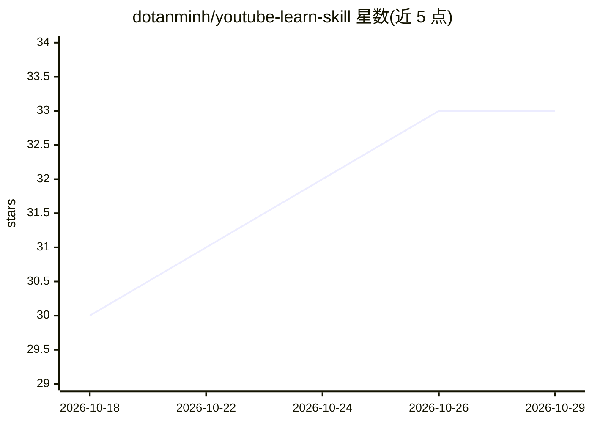

# dotanminh/youtube-learn-skill

⭐ 33 · Python · MIT · 推送 2026-07-06 · [GitHub](https://github.com/dotanminh/youtube-learn-skill) · 个人维护 · 中文 README

**AI Agent 技能：从 YouTube 视频挖掘讲者世界观与隐藏信念**

面向 Antigravity / Gemini CLI 的 Agent 技能包：以 'Belief Archaeology' 方式分析 YouTube 视频，而非简单摘要。通过 yt-dlp 下载视频/音频、youtube-transcript-api 获取 transcript、ffmpeg 按时长均分截取 8-24 张幻灯片帧，供多模态 Agent 观察读取；经 8 阶段 pipeline 提取讲者画像与至多 3 个世界观，按 P.A.R.A 结构存储，配有集中式讲者档案、QA 脚本 verify_output.py 校验输出结构。也可脱离 Agent 直接运行 watch_video.py 脚本。

## 筛选速览

| 维度 | 判定 | 备注 |
|---|---|---|
| AI 角色 | `ai-ecosystem` | LLM/agent 周边工具 |
| 许可风险 | `permissive` | MIT |
| 部署形态 | `library` | 以包/库形式分发 |
| 模型依赖 | — | README 未给出锁定关系 |
| 硬件要求 | — | 无带数字的原话,不猜 |
| 安装摩擦 | `medium` | 含编译或系统依赖之一 |
| 成熟度 | — | 结构信号不足 |

## 能力要点

- 多模态分析：下载视频并均分截取 8-24 帧供 Agent 读取幻灯片文字
- 8 阶段 pipeline：数据采集→讲者画像→世界观提取（至多 3 个）
- 集中式 speakers/ 讲者档案，跨视频积累更新
- verify_output.py 自动化质量门：校验目录结构与索引一致性

## 适用场景

- 让 AI Agent 深度分析 YouTube 讲座视频的世界观与思维模型
- 跨视频积累讲者画像与信念档案，构建个人知识库
- 批量下载视频、transcript 与幻灯片帧用于离线分析

## 场景标签

`知识库管理` · 领域:知识与检索

## 证据(README 行号)

> L3: > **Skill dành cho AI Agent - đào sâu thế giới quan (worldview), niềm tin ẩn và trực quan slide bài giảng của speake
> L29: ### 2. Dành cho người dùng Antigravity / Gemini CLI
> L97: - Xây dựng tối ưu cho nền tảng Google Antigravity AI Agent.

## 星数曲线

2026-10-18 30 → 2026-10-29 33（+3）

---
*卡片 v1 · prompt 1.4 · 生成 2026-10-26 · 置信度 mid · 依据 README sha `624a6384f1b0` · [字段定义](../../DATASET.md)*
