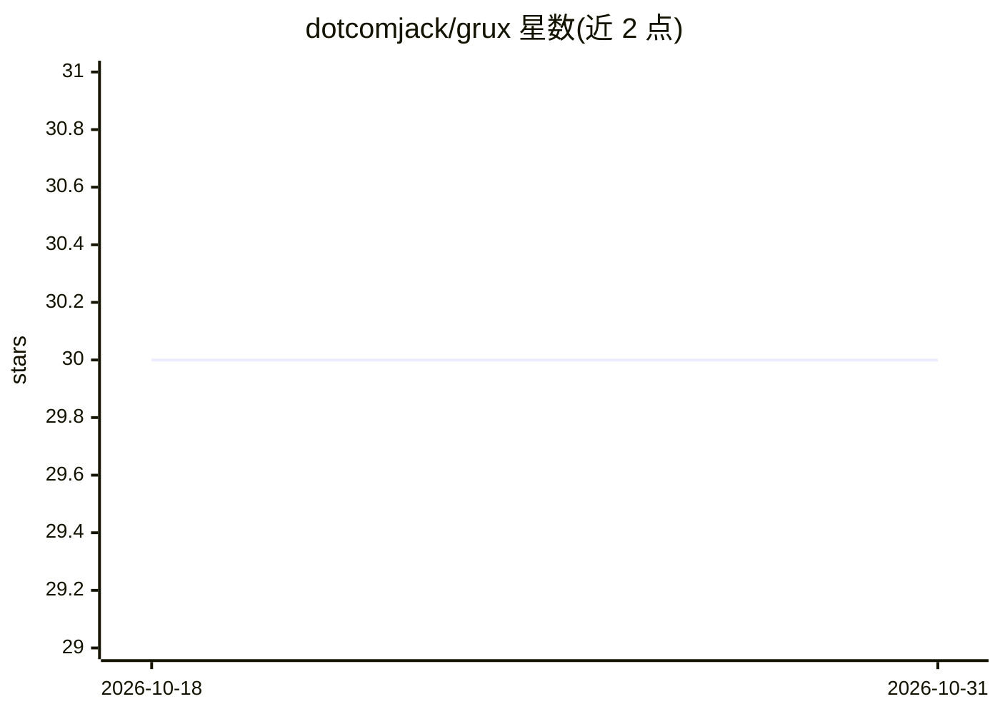

# dotcomjack/grux

⭐ 30 · Swift · MIT · 推送 2026-10-30 · [GitHub](https://github.com/dotcomjack/grux) · [官网](https://gruxai.com) · 个人维护

**macOS 本地优先的开源 AI agent：统一管理邮件/日历/会议/文件与可撤销 shell**

面向 macOS 用户的原生桌面 AI agent 应用：以 Command Panel 为入口，接入本机邮件、日历、联系人、笔记、文档与会议，可在项目中开启持久终端会话并执行命令，每条命令先快照到影子 git 仓库以便撤销；支持并行 agent 编组、iOS 模拟器构建运行、屏幕操作、会议转录与说话人分离。模型侧支持自有 API key 或经 Ollama 运行本地模型（无 key），并发布自训的 Grux Local 系列（Qwen 3.5 微调，2B/4B/9B 按内存分档）。分发方式为签名公证的 DMG 与 Homebrew cask，无账户与订阅。

## 筛选速览

| 维度 | 判定 | 备注 |
|---|---|---|
| AI 角色 | `ai-native` | 本体是模型或模型工具 |
| 许可风险 | `permissive` | MIT |
| 部署形态 | `desktop` | 安装包/桌面程序 |
| 模型依赖 | local-ok | 支持本地模型 |
| 硬件要求 | — | 无带数字的原话,不猜 |
| 安装摩擦 | `low` | 无编译、无系统依赖或容器化 |
| 成熟度 | `idea` | |

## 能力要点

- shell 命令先快照进影子 git 仓库，agent 操作可撤销
- 自有本地模型 Grux Local（Qwen 3.5 微调，2B/4B/9B 三档，按 Mac 内存匹配）
- 接入本机邮件、日历、会议、文件，会议转录与说话人分离在设备端完成
- 37 项功能 / 116 个工具集成于单一原生窗口，附命令行

## 适用场景

- 用本地模型无 key 地处理邮件、日历与会议纪要
- 让 agent 在项目里跑 shell 命令且可回滚
- 在 Mac 上本地转录会议并区分说话人
- 通过 Optimize Grux 让 agent 生成改造工单再自行构建

## 场景标签

`AI 助手` `编码 Agent` `语音识别` · 领域:编码与开发

## 证据(README 行号)

> L3: **Grux is an open source, local-first AI agent for macOS.** It is a native app that
> L30: It talks to a model you pay for directly, or to a local model with no key at all.
> L90: Grux's own local model, for when you want chat on your Mac and no key at all. It is

## 星数曲线

2026-10-18 30 → 2026-10-31 30（+0）

---
*卡片 v1 · prompt 1.4 · 生成 2026-10-26 · 置信度 mid · 依据 README sha `48674eae726b` · [字段定义](../../DATASET.md)*
