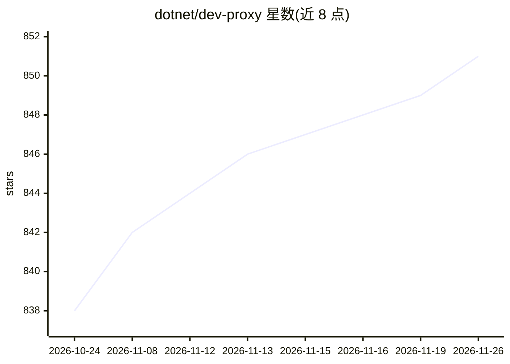

# dotnet/dev-proxy

⭐ 851 · C# · MIT · 推送 2026-11-25 · [GitHub](https://github.com/dotnet/dev-proxy) · [官网](https://aka.ms/devproxy) · 组织维护

**命令行 API 模拟器：让开发者测试应用对故障限流的处理**

Dev Proxy 是一个跨平台命令行 API 模拟器，通过拦截网络请求模拟 API 错误、限流与慢响应，应用代码无需修改，且不依赖特定语言、框架或 API。提供无需编码即可启动的 mock API、预设配置（GitHub/OpenAI/Anthropic/Microsoft Graph 等）、GitHub Actions 弹性测试集成，并可通过 MCP server 用自然语言配置。安装覆盖 Windows/macOS/Linux 及 dev containers，首次使用需信任其证书以拦截 HTTPS 请求。

## 筛选速览

| 维度 | 判定 | 备注 |
|---|---|---|
| AI 角色 | `ai-enhanced` | 去掉 AI 部分产品仍成立 |
| 许可风险 | `permissive` | MIT |
| 部署形态 | `None` |  |
| 模型依赖 | — | README 未给出锁定关系 |
| 硬件要求 | — | 无带数字的原话,不猜 |
| 安装摩擦 | `medium` | 含编译或系统依赖之一 |
| 成熟度 | — | 结构信号不足 |

## 能力要点

- 拦截网络请求，模拟 API 错误、限流与慢响应，无需修改应用代码
- 路由 OpenAI 兼容请求到本地语言模型并模拟 LLM 故障
- GitHub Actions 集成，可在 CI/CD 中自动化弹性测试
- MCP server 支持用自然语言由 AI 编码代理配置

## 适用场景

- 测试我的应用在 API 出错或限流时的表现
- 在不消耗 token 的情况下测试 AI 应用
- 在 CI/CD 流水线里自动化弹性测试
- 快速搭起 mock API 以便专注开发应用

## 场景标签

 · 领域:开发者工具/API 测试

## 证据(README 行号)

> L16: Dev Proxy is an API simulator that helps you test how your app handles errors, throttling, and slow responses, with
> L30: - **Test your AI apps** by routing OpenAI-compatible requests to a local language model and simulating LLM failures

## 星数曲线

2026-10-24 838 → 2026-11-26 851（+13）

---
*卡片 v1 · prompt 1.4 · 生成 2026-11-24 · 置信度 high · 依据 README sha `d2f5f87b1925` · [字段定义](../../DATASET.md)*
