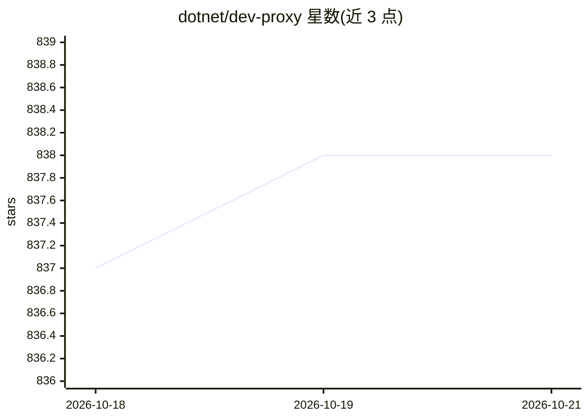

# dotnet/dev-proxy

⭐ 838 · C# · MIT · 推送 2026-10-22 · [GitHub](https://github.com/dotnet/dev-proxy) · [官网](https://aka.ms/devproxy) · 组织维护

**命令行 API 模拟器：无需改代码即可测试应用的容错与限流**

跨平台命令行工具，通过拦截网络请求模拟 API 错误、限流与慢响应，适用于任意语言、框架与 API，无需修改应用代码。可快速搭建 mock API、在 CI/CD 中用 GitHub Actions 自动化韧性测试，并提供针对 GitHub、OpenAI、Anthropic、Microsoft Graph 的限流预设。AI 相关能力：将 OpenAI 兼容请求路由到本地语言模型并模拟 LLM 故障，附带 Dev Proxy MCP server 供 AI 编码代理用自然语言配置。首次使用需信任其 HTTPS 拦截证书。由 dotnet 组织维护，受 .NET Foundation 支持。

## 筛选速览

| 维度 | 判定 | 备注 |
|---|---|---|
| AI 角色 | `ai-enhanced` | 去掉 AI 部分产品仍成立 |
| 许可风险 | `permissive` | MIT |
| 部署形态 | `None` |  |
| 模型依赖 | — | README 未给出锁定关系 |
| 硬件要求 | — | 无带数字的原话,不猜 |
| 安装摩擦 | `medium` | 含编译或系统依赖之一 |
| 成熟度 | — | 结构信号不足 |

## 能力要点

- 拦截网络请求模拟 API 错误、限流、慢响应，不改应用代码
- 将 OpenAI 兼容请求路由到本地语言模型并模拟 LLM 故障
- 内置 Dev Proxy MCP server，可用自然语言配置
- 提供 GitHub/OpenAI/Anthropic/Microsoft Graph 限流预设与 GitHub Actions 集成

## 适用场景

- 测试应用在 API 报错或被限流时的表现
- 不写代码快速搭建 mock API
- 在不消耗 token 的情况下测试 AI 应用的故障场景
- 在 CI/CD 流水线中自动化韧性测试

## 场景标签

`模型网关` · 领域:Agent 开发

## 证据(README 行号)

> L16: Dev Proxy is an API simulator that helps you test how your app handles errors, throttling, and slow responses, with
> L30: - **Test your AI apps** by routing OpenAI-compatible requests to a local language model and simulating LLM failures
> L32: - **Configure Dev Proxy in plain English** using the Dev Proxy MCP server with your AI coding agent, so that you ca

## 星数曲线

2026-10-18 837 → 2026-10-21 838（+1）

---
*卡片 v1 · prompt 1.4 · 生成 2026-10-21 · 置信度 high · 依据 README sha `495968d1bcad` · [字段定义](../../DATASET.md)*
