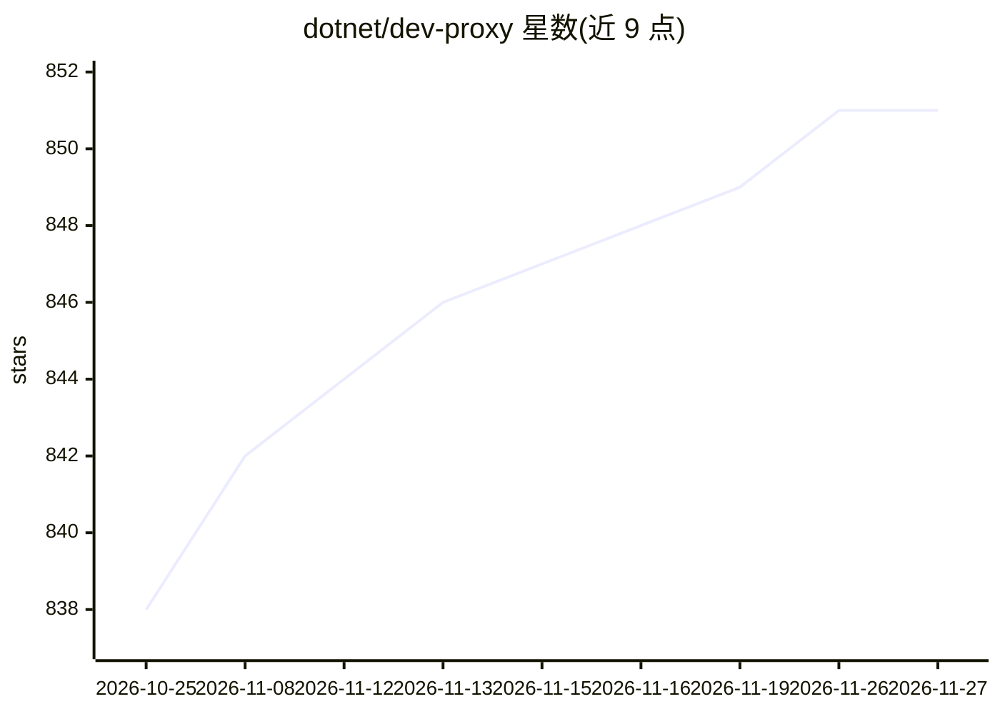

# dotnet/dev-proxy

⭐ 851 · C# · MIT · 推送 2026-11-26 · [GitHub](https://github.com/dotnet/dev-proxy) · [官网](https://aka.ms/devproxy) · 组织维护

**命令行 API 模拟器：模拟故障/限流/慢响应来测试应用**

Dev Proxy 是一个跨平台命令行 API 模拟器，通过拦截网络请求，在不修改应用代码的情况下模拟 API 错误、限流与慢响应，适用于任何语言、框架和 API。提供无代码快速搭建 mock API、GitHub Actions 集成做 CI/CD 韧性测试、API 使用上下文建议等能力；可将 OpenAI 兼容请求路由到本地语言模型并模拟 LLM 故障，也可通过 MCP server 用自然语言由 AI 编码代理配置。提供 GitHub/Graph 等预设配置，首次使用需信任其 HTTPS 证书。

## 筛选速览

| 维度 | 判定 | 备注 |
|---|---|---|
| AI 角色 | `ai-enhanced` | 去掉 AI 部分产品仍成立 |
| 许可风险 | `permissive` | MIT |
| 部署形态 | `None` |  |
| 模型依赖 | — | README 未给出锁定关系 |
| 硬件要求 | — | 无带数字的原话,不猜 |
| 安装摩擦 | `medium` | 含编译或系统依赖之一 |
| 成熟度 | — | 结构信号不足 |

## 能力要点

- 拦截网络请求即可模拟 API 错误/限流/慢响应，无需改代码
- 将 OpenAI 兼容请求路由到本地模型并模拟 LLM 故障
- 通过 Dev Proxy MCP server 用自然语言配置
- GitHub Actions 集成实现 CI/CD 韧性测试

## 适用场景

- 测试应用对 API 故障、限流和慢响应的处理
- 不消耗 token 地测试 AI 应用
- 在 CI/CD 流水线中自动化韧性测试
- 不写代码快速搭建 mock API

## 场景标签

 · 领域:开发者工具/API 测试

## 证据(README 行号)

> L16: Dev Proxy is an API simulator that helps you test how your app handles errors, throttling, and slow responses, with
> L30: - **Test your AI apps** by routing OpenAI-compatible requests to a local language model and simulating LLM failures
> L32: - **Configure Dev Proxy in plain English** using the Dev Proxy MCP server with your AI coding agent, so that you ca

## 星数曲线

2026-10-25 838 → 2026-11-27 851（+13）

---
*卡片 v1 · prompt 1.4 · 生成 2026-11-27 · 置信度 high · 依据 README sha `f7b36f26749f` · [字段定义](../../DATASET.md)*
