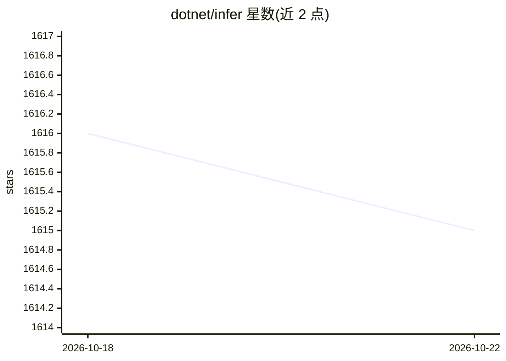

# dotnet/infer

⭐ 1,615 · C# · MIT · 推送 2026-07-14 · [GitHub](https://github.com/dotnet/infer) · [官网](https://dotnet.github.io/infer/) · 组织维护

**在图模型上运行贝叶斯推断的 .NET 概率编程框架**

Infer.NET 是用于在图模型上运行贝叶斯推断、并可做概率编程的 .NET 框架，可解决分类、推荐、聚类等机器学习问题，应用于信息检索、生物信息学、流行病学、视觉等领域。核心机制是编译器将用其 API 描述的模型转换为推断代码，另有实验性的 Csoft 特性支持用 C# 子集表达概率模型，以及完整的分类器与推荐器学习器包。以四个 NuGet 包分发，目标 .NET Standard 2.0，跨 Windows/Linux/macOS。

## 筛选速览

| 维度 | 判定 | 备注 |
|---|---|---|
| AI 角色 | `ai-native` | 本体是模型或模型工具 |
| 许可风险 | `permissive` | MIT |
| 部署形态 | `None` |  |
| 模型依赖 | — | README 未给出锁定关系 |
| 硬件要求 | — | 无带数字的原话,不猜 |
| 安装摩擦 | `medium` | 含编译或系统依赖之一 |
| 成熟度 | — | 结构信号不足 |

## 能力要点

- 编译器将 API 描述的模型转换为推断代码
- Csoft 实验特性：用 C# 子集表达概率模型
- Learners 包提供完整分类器与推荐系统
- 含 LDA 主题模型、MotifFinder 等示例与 F#/IronPython 包装

## 适用场景

- 在 .NET 项目中构建贝叶斯推断与概率编程模型
- 实现分类、推荐、聚类等机器学习任务
- 解决生物信息学等领域的定制化概率建模问题

## 场景标签

 · 领域:机器学习/概率编程

## 证据(README 行号)

> L3: **Infer&#46;NET** is a framework for running Bayesian inference in graphical models. It can also be used for probabi
> L5: One can use Infer&#46;NET to solve many different kinds of machine learning problems - from standard problems like c

## 星数曲线

2026-10-18 1,616 → 2026-10-22 1,615（-1）

---
*卡片 v1 · prompt 1.4 · 生成 2026-10-21 · 置信度 high · 依据 README sha `a2a82b5aa7c1` · [字段定义](../../DATASET.md)*
