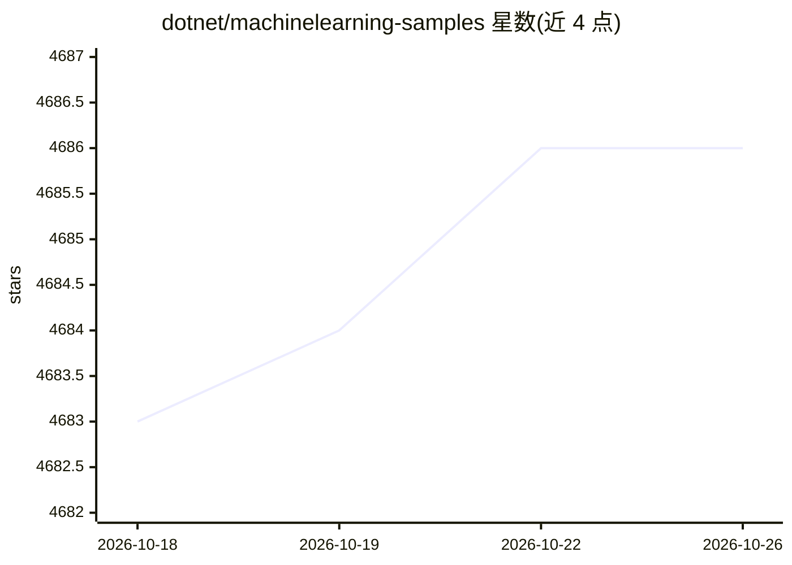

# dotnet/machinelearning-samples

⭐ 4,686 · PowerShell · MIT · 推送 2026-09-03 · [GitHub](https://github.com/dotnet/machinelearning-samples) · [官网](https://dot.net/ml) · 组织维护 · 中文 README

**ML.NET 官方示例库：面向 .NET 开发者的机器学习入门样例集**

微软 dotnet 组织维护的 ML.NET 框架官方示例仓库，覆盖二分类、多分类、推荐、回归、时序预测、异常检测、聚类、排序与计算机视觉等任务的入门级控制台示例，以及嵌入 ML 模型的端到端 Web/桌面应用（WebAPI、Razor、Azure Functions、Blazor）。另含 ML.NET CLI 与 AutoML API（标注 Preview 状态）的自动化建模示例，并提供社区示例索引与简体中文翻译入口。

## 筛选速览

| 维度 | 判定 | 备注 |
|---|---|---|
| AI 角色 | `ai-knowledge` | 知识聚合/清单类 |
| 许可风险 | `permissive` | MIT |
| 部署形态 | `None` |  |
| 模型依赖 | — | README 未给出锁定关系 |
| 硬件要求 | — | 无带数字的原话,不猜 |
| 安装摩擦 | `medium` | 含编译或系统依赖之一 |
| 成熟度 | `idea` | |

## 能力要点

- 按 9 类机器学习任务组织的入门代码示例（C#/F#）
- 端到端应用示例覆盖 WebAPI、Razor、Azure Functions、Blazor 部署形态
- 含 ML.NET CLI 与 AutoML API 的自动化模型生成示例
- 支持导出 ONNX 与加载预训练 TensorFlow/ONNX 模型评分

## 适用场景

- 我刚开始用 ML.NET，想找各任务的入门代码样例
- 我想看如何在 .NET Web 应用中集成 ML 模型部署
- 我想用 CLI 或 AutoML 自动生成训练代码与模型

## 场景标签

`教程课程` · 领域:学习与行业

## 证据(README 行号)

> L3: ML.NET is a cross-platform open-source machine learning framework that makes machine learning accessible to .NET dev
> L11: * Getting Started : ML.NET code focused samples for each ML task or area, usually implemented as simple console app
> L15: The official ML.NET samples are divided in multiple categories depending on the scenario and machine learning probl

## 星数曲线

2026-10-18 4,683 → 2026-10-26 4,686（+3）

---
*卡片 v1 · prompt 1.4 · 生成 2026-10-20 · 置信度 high · 依据 README sha `091b6f65792c` · [字段定义](../../DATASET.md)*
