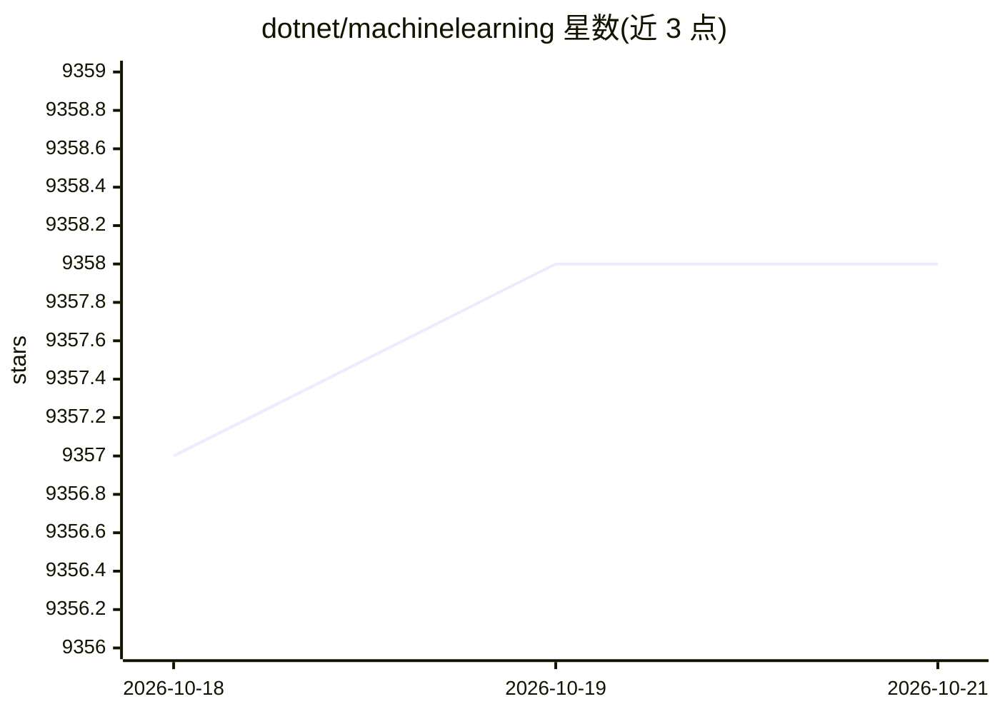

# dotnet/machinelearning

⭐ 9,358 · C# · MIT · 推送 2026-10-19 · [GitHub](https://github.com/dotnet/machinelearning) · [官网](https://dot.net/ml) · 组织维护

**面向 .NET 的跨平台开源机器学习框架**

ML.NET 是面向 .NET 生态的跨平台开源机器学习框架，让 .NET 开发者在不依赖 Python/R 的情况下构建、训练、部署和使用自定义模型。功能覆盖文件与数据库数据加载、数据变换及多种机器学习算法，支持分类、预测、异常检测等场景；并可调用 TensorFlow 与 ONNX 模型以扩展场景。主包 Microsoft.ML 基于 .NET Standard 2.0，通过 NuGet 安装；运行于 Windows/Linux/macOS，支持 ARM64 与 Apple silicon（部分功能有限制）。由 .NET 基金会项目、随 .NET 大版本每年发布一次。

## 筛选速览

| 维度 | 判定 | 备注 |
|---|---|---|
| AI 角色 | `ai-ecosystem` | LLM/agent 周边工具 |
| 许可风险 | `permissive` | MIT |
| 部署形态 | `None` |  |
| 模型依赖 | — | README 未给出锁定关系 |
| 硬件要求 | — | 无带数字的原话,不猜 |
| 安装摩擦 | `medium` | 含编译或系统依赖之一 |
| 成熟度 | — | 结构信号不足 |

## 能力要点

- 在 .NET 应用内训练与推理自定义模型，无需 Python/R
- 内置多种算法，覆盖分类、预测、异常检测
- 可消费 TensorFlow 与 ONNX 模型
- 跨平台支持 Windows/Linux/macOS，含 ARM64 与 Apple silicon

## 适用场景

- 在现有 .NET 应用中直接集成模型训练与预测
- 用 C# 处理文本情感分析等常见 ML 场景
- 复用已有 TensorFlow/ONNX 模型做 .NET 端推理

## 场景标签

`模型训练` · 领域:训练与推理

## 证据(README 行号)

> L3: ML.NET is a cross-platform open-source machine learning (ML) framework for .NET.
> L5: ML.NET allows developers to easily build, train, deploy, and consume custom models in their .NET applications withou
> L9: You can also consume both TensorFlow and ONNX models within ML.NET which makes the framework more extensible and exp

## 星数曲线

2026-10-18 9,357 → 2026-10-21 9,358（+1）

---
*卡片 v1 · prompt 1.4 · 生成 2026-10-20 · 置信度 high · 依据 README sha `f29c7f3b7515` · [字段定义](../../DATASET.md)*
