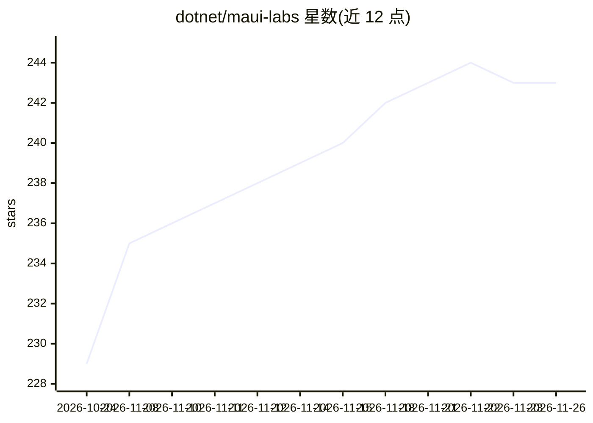

# dotnet/maui-labs

⭐ 243 · C# · MIT · 推送 2026-11-25 · [GitHub](https://github.com/dotnet/maui-labs) · [官网](https://dot.net/maui) · 组织维护

**.NET MAUI 实验性工具与包集合，含设备端 AI API**

dotnet/maui-labs 托管 .NET MAUI 的预发布实验项目，以多个独立 NuGet 包交付：maui CLI（环境诊断、模拟器与设备管理、应用自动化）、Comet MVU UI 框架、DevFlow 测试调试工具（含 MCP server）、AI Extensions 源生成工具绑定、Linux GTK4/macOS AppKit/WPF 三个平台后端、Essentials.AI 设备端聊天与嵌入 API、测试与构建辅助包。官方声明这些包不受 .NET MAUI 支持策略覆盖，API 可能随版本变化。

## 筛选速览

| 维度 | 判定 | 备注 |
|---|---|---|
| AI 角色 | `ai-enhanced` | 去掉 AI 部分产品仍成立 |
| 许可风险 | `permissive` | MIT |
| 部署形态 | `None` |  |
| 模型依赖 | — | README 未给出锁定关系 |
| 硬件要求 | — | 无带数字的原话,不猜 |
| 安装摩擦 | `high` | 编译与系统依赖俱全 |
| 成熟度 | `idea` | |

## 能力要点

- maui CLI 提供 maui doctor 诊断、Android SDK/JDK 与模拟器管理
- DevFlow 提供 UI 检查、自动化、网络监控及供 AI agent 调用的 MCP server
- Essentials.AI 支持设备端聊天、嵌入与工具调用（Apple Intelligence/Windows AI/Gemini Nano）
- 提供 Linux GTK4、macOS AppKit、WPF 平台后端

## 适用场景

- 为 MAUI 应用启用设备端聊天补全与嵌入
- 通过 CLI 自动化搭建与诊断 MAUI 开发环境
- 为 .NET Android/iOS 应用做 UI 自动化调试
- 在 Linux 或原生 AppKit/WPF 桌面运行 MAUI 应用

## 场景标签

 · 领域:移动与桌面应用开发工具

## 证据(README 行号)

> L3: Experimental packages and tooling for .NET MAUI. This repository hosts pre-release projects that are in active devel
> L21: |Essentials.AI|On-device AI APIs for chat completion, embeddings, and tool calling in MAUI apps.|
> L78: - **MCP server** for AI agent integration (via `maui devflow mcp`)

## 星数曲线

2026-10-24 229 → 2026-11-26 243（+14）

---
*卡片 v1 · prompt 1.4 · 生成 2026-11-25 · 置信度 high · 依据 README sha `5ac7b708b49d` · [字段定义](../../DATASET.md)*
