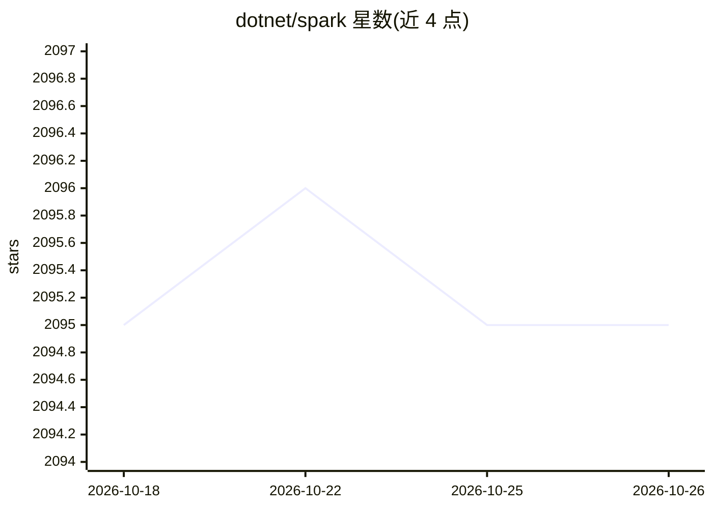

# dotnet/spark

⭐ 2,095 · C# · MIT · 推送 2026-10-15 · [GitHub](https://github.com/dotnet/spark) · [官网](https://dot.net/spark) · 组织维护

**让 .NET 开发者用 C#/F# 使用 Apache Spark 的绑定库**

微软 .NET Foundation 下的 Apache Spark .NET 语言绑定：提供 C#/F# 的 DataFrame、Spark SQL 与 Structured Streaming API，通过 .NET Worker、Scala bridge 与 JVM 之间的数据传输（Apache Arrow 列式/Pyrolite 行式）对接 Spark 运行时。支持 Spark 3.0–3.5，2.4.0 版新增 Spark 4.0.0–4.0.4 集成（.NET 8、Scala 2.13、JDK 17）并移除 Spark 2.x 支持；Spark 4 的原生 .NET Variant 值与 Variant UDF 不支持。提供 Azure HDInsight、Amazon EMR、Databricks 部署指南及 TPC-H 基准示例。

## 筛选速览

| 维度 | 判定 | 备注 |
|---|---|---|
| AI 角色 | `ai-enhanced` | 去掉 AI 部分产品仍成立 |
| 许可风险 | `permissive` | MIT |
| 部署形态 | `None` |  |
| 模型依赖 | — | README 未给出锁定关系 |
| 硬件要求 | — | 无带数字的原话,不猜 |
| 安装摩擦 | `medium` | 含编译或系统依赖之一 |
| 成熟度 | — | 结构信号不足 |

## 能力要点

- C#/F# 的 DataFrame、Spark SQL、Structured Streaming API
- Spark 3.0–3.5 运行时支持，2.4.0 新增 Spark 4.0.x 集成
- Azure HDInsight / Amazon EMR / Databricks 部署指南
- Kafka 流处理与 TPC-H 基准查询示例

## 适用场景

- 在 C#/F# 代码中编写 Spark 结构化数据与流处理作业
- 将 .NET 大数据作业部署到 Databricks、EMR 或 HDInsight
- 用 DataFrame API 或 SQL 表达 TPC-H 基准查询

## 场景标签

 · 领域:大数据/分布式计算

## 证据(README 行号)

> L8: .NET for Apache Spark provides high-performance APIs for using Apache Spark from C# and F#. Use DataFrames and Spark
> L10: `Microsoft.Spark` targets .NET Standard 2.0 and 2.1. Running an application also requires a compatible .NET Worker,

## 星数曲线

2026-10-18 2,095 → 2026-10-26 2,095（+0）

---
*卡片 v1 · prompt 1.4 · 生成 2026-10-21 · 置信度 high · 依据 README sha `63a9e0ac722b` · [字段定义](../../DATASET.md)*
