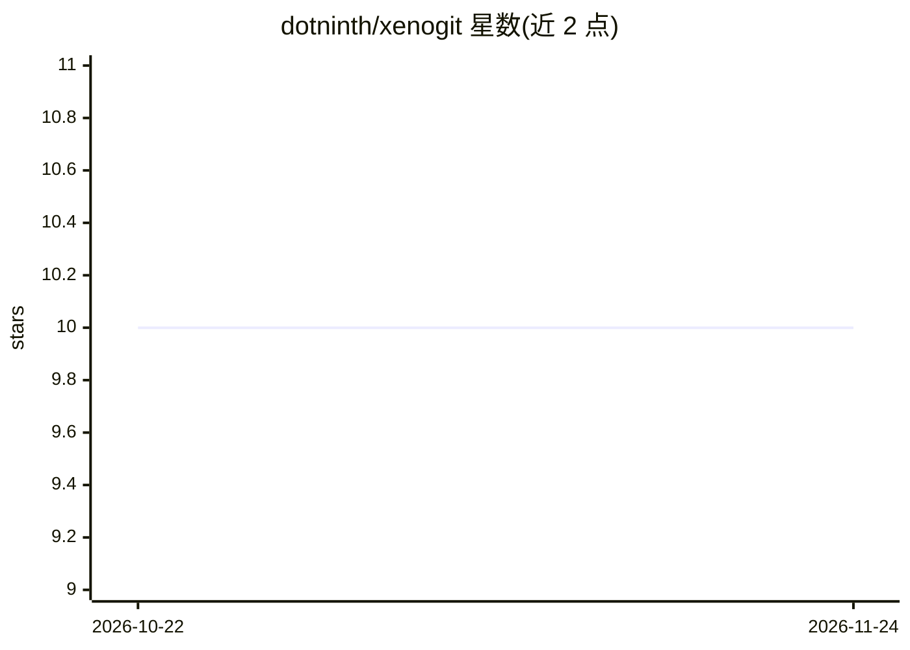

# dotninth/xenogit

⭐ 10 · PHP · MIT · 推送 2026-09-06 · [GitHub](https://github.com/dotninth/xenogit) · 个人维护

**开发者 CLI：用 Gemini 生成 Git 提交信息**

基于 PHP 的命令行工具，读取 Git 变更并调用 Google Gemini API 自动生成提交信息，支持通过 -m 参数在多个 Gemini 模型间切换。需要用户配置 Google AI Studio 的 API key（支持命令行、环境变量或 .env 文件三种方式）。通过 Composer 全局安装或从 GitHub Releases 下载二进制文件，按 MIT 许可发布，API 调用费用由用户承担。

## 筛选速览

| 维度 | 判定 | 备注 |
|---|---|---|
| AI 角色 | `ai-native` | 本体是模型或模型工具 |
| 许可风险 | `permissive` | MIT |
| 部署形态 | `desktop` | 安装包/桌面程序 |
| 模型依赖 | — | README 未给出锁定关系 |
| 硬件要求 | — | 无带数字的原话,不猜 |
| 安装摩擦 | `low` | 无编译、无系统依赖或容器化 |
| 成熟度 | — | 结构信号不足 |

## 能力要点

- 调用 Google Gemini 生成提交信息，支持 -m 切换多种模型
- API key 支持命令、环境变量、.env 三种配置方式
- 提供 Composer 全局安装与 GitHub Releases 二进制两种安装途径
- 附带简化工作流的 bash aliases 示例

## 适用场景

- 避免手动编写 Git 提交信息
- 为大型变更选择 Pro 模型生成提交描述
- 用 bash 别名把 add/commit/push 流程串起来

## 场景标签

`代码生成` · 领域:编码与开发

## 证据(README 行号)

> L18: `Xenogit` is your helpful command-line assistant that uses Google Gemini to quickly create commit messages.
> L55: You can use the following models from Google with the `-m` flag:

## 星数曲线

2026-10-22 10 → 2026-11-24 10（+0）

---
*卡片 v1 · prompt 1.4 · 生成 2026-11-19 · 置信度 high · 依据 README sha `294796225021` · [字段定义](../../DATASET.md)*
