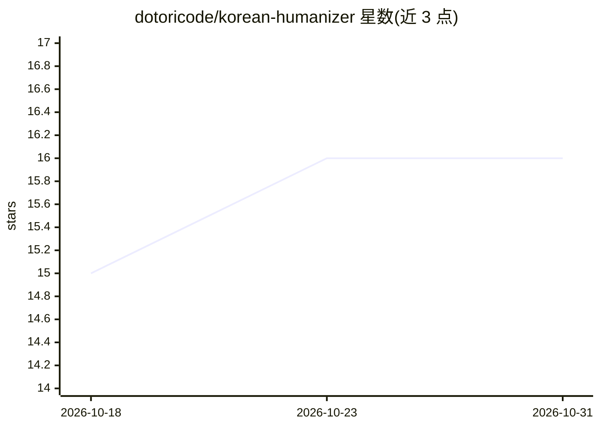

# dotoricode/korean-humanizer

⭐ 16 · Python · MIT · 推送 2026-10-30 · [GitHub](https://github.com/dotoricode/korean-humanizer) · [官网](https://github.com/dotoricode/korean-humanizer/wiki) · 个人维护

**为 Claude Code/Codex 提供的韩语去 AI 味润色技能与提示词**

一套安装到 Claude Code 与 Codex CLI 的 agent 技能与提示词：调用 /korean-humanizer 或 $korean-humanizer 后对韩语文本做保持原意的改写，去除 AI 生成文风的生硬表达。提供上下文相关的编辑模式目录而非机械替换，支持禁用词、偏好词与品牌语气自定义；README 记录了两种 CLI 下的模型输出对比（LinkedIn/邮件/营销文案三类），并声明这些是指令而非模型合规的保证。其他 LLM 可直接粘贴 PROMPT.md 作为系统提示使用。

## 筛选速览

| 维度 | 判定 | 备注 |
|---|---|---|
| AI 角色 | `ai-ecosystem` | LLM/agent 周边工具 |
| 许可风险 | `permissive` | MIT |
| 部署形态 | `library` | 以包/库形式分发 |
| 模型依赖 | — | README 未给出锁定关系 |
| 硬件要求 | — | 无带数字的原话,不猜 |
| 安装摩擦 | `low` | 无编译、无系统依赖或容器化 |
| 成熟度 | — | 结构信号不足 |

## 能力要点

- 以 Skills CLI 安装到 Codex 与 Claude Code 的技能文件
- 模式目录提供依上下文的编辑候选，保留事实/语气/条件
- 支持禁用词、偏好与品牌语气自定义（personal 文件）
- 其他 LLM 可通过粘贴 PROMPT.md 使用

## 适用场景

- 我在写韩语邮件或 LinkedIn 帖子时让 agent 去掉 AI 味
- 按品牌语气偏好统一润色韩语文案
- 在 Codex/Claude Code 项目中随时调用韩语润色技能

## 场景标签

`提示工程` `AI 写作` · 领域:Agent 开发

## 证据(README 行号)

> L71: Run this command in the project where you want to use the skill. It uses the Skills CLI and requires Node.js/npm.
> L74: npx skills add dotoricode/korean-humanizer --skill korean-humanizer --agent codex claude-code --copy
> L79: Start a new conversation in that project and invoke `$korean-humanizer` in Codex or `/korean-humanizer` in Claude C

## 星数曲线

2026-10-18 15 → 2026-10-31 16（+1）

---
*卡片 v1 · prompt 1.4 · 生成 2026-10-30 · 置信度 high · 依据 README sha `4580cceeb1e9` · [字段定义](../../DATASET.md)*
