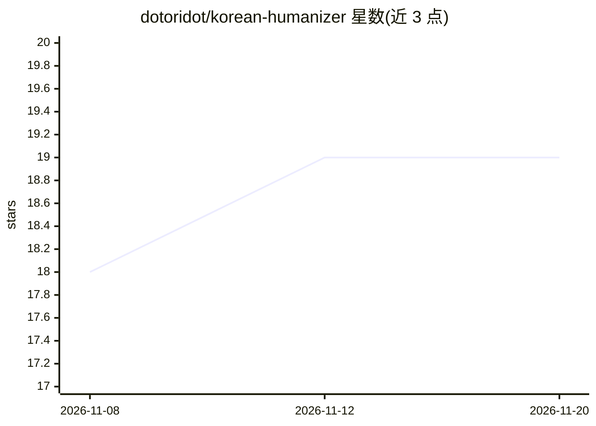

# dotoridot/korean-humanizer

⭐ 19 · Python · MIT · 推送 2026-11-08 · [GitHub](https://github.com/dotoridot/korean-humanizer) · [官网](https://github.com/dotoricode/korean-humanizer/wiki) · 个人维护

**去除韩语 AI 文本痕迹的提示词/技能包**

面向 Claude Code 与 Codex 的提示词技能：按模式目录对韩语 AI 生成文进行保义改写，保留事实、数字、语气与条件，重写生硬措辞，不设编辑数量上限。通过第三方 Skills CLI（npx skills add）安装到 .agents/skills/ 或 .claude/skills/ 目录，之后以 $korean-humanizer 或 /korean-humanizer 调用；其他 LLM 可将 PROMPT.short.md 作为系统提示词使用。支持禁用词、偏好词与品牌语气的自定义；另有独立的 korean-humanizer-deep 技能处理结构与事实修订。README 附带 Claude Code（Opus 5.5）与 Codex CLI（GPT-6 Astra）的首轮响应对比示例及第三方社区演示链接。

## 筛选速览

| 维度 | 判定 | 备注 |
|---|---|---|
| AI 角色 | `ai-native` | 本体是模型或模型工具 |
| 许可风险 | `permissive` | MIT |
| 部署形态 | `library` | 以包/库形式分发 |
| 模型依赖 | — | README 未给出锁定关系 |
| 硬件要求 | — | 无带数字的原话,不猜 |
| 安装摩擦 | `low` | 无编译、无系统依赖或容器化 |
| 成熟度 | — | 结构信号不足 |

## 能力要点

- 保义保语气的韩语 AI 文改写规则集与模式目录
- 通过 npx skills add 安装，支持 Codex 与 Claude Code 两种 agent
- 支持禁用词、偏好替换与品牌语气自定义（personal=path、brand-voice 模板）
- 其他 LLM 可直接使用 PROMPT.short.md / PROMPT.md 作为系统提示词

## 适用场景

- 把 AI 生成的韩语邮件、LinkedIn 帖子、营销文案改写得更自然
- 为团队设定统一禁用词与品牌语气后批量润色韩语文本
- 在 Claude Code 或 Codex 会话中随时调用技能处理韩语初稿

## 场景标签

`提示工程` `AI 写作` · 领域:Agent 开发

## 证据(README 行号)

> L3: > A skill and prompt for editing awkward Korean AI prose while preserving meaning.
> L75: npx skills add dotoridot/korean-humanizer --skill korean-humanizer --agent codex claude-code --copy

## 星数曲线

2026-11-08 18 → 2026-11-20 19（+1）

---
*卡片 v1 · prompt 1.4 · 生成 2026-11-18 · 置信度 high · 依据 README sha `48bc3f39973e` · [字段定义](../../DATASET.md)*
