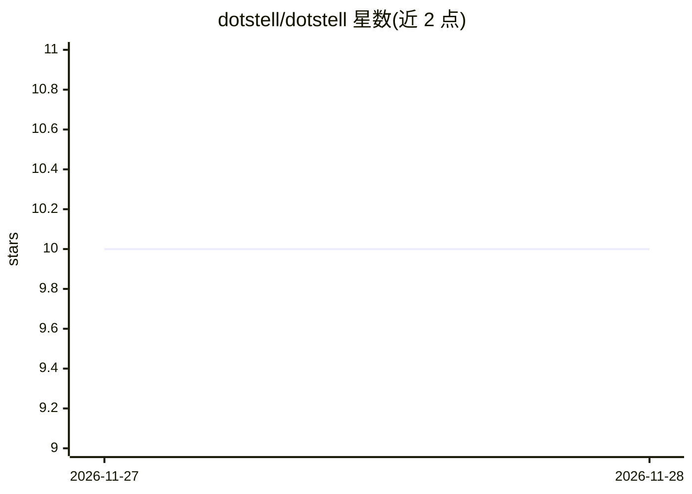

# dotstell/dotstell

⭐ 10 · TypeScript · AGPL-3.0 · 推送 2026-11-09 · [GitHub](https://github.com/dotstell/dotstell) · [官网](https://dotstell.app) · 组织维护

**自托管个人知识图谱：笔记/人脉/任务互联并接入 AI**

Dotstell 是一个开源个人知识图谱应用，将笔记、联系人、任务、书签通过 wikilinks 和可视化图谱互联，支持 Markdown 导入导出（兼容 Obsidian 格式）。AI 层提供基于自有笔记的 RAG 问答、会议纪要转行动项、语音听写、写作助手和图谱补链，可配置本地 Ollama 或云厂商 API key。提供 Web、桌面应用（Windows/macOS/Linux）与手机端，自托管需自建 Supabase 项目与 Node.js 主机，内置 MCP server 供外部 AI 工具读取数据。许可证为 AGPL-3.0。

## 筛选速览

| 维度 | 判定 | 备注 |
|---|---|---|
| AI 角色 | `ai-enhanced` | 去掉 AI 部分产品仍成立 |
| 许可风险 | `viral` | AGPL-3.0 |
| 部署形态 | `library` | 以包/库形式分发 |
| 模型依赖 | local-ok | 支持本地模型 |
| 硬件要求 | — | 无带数字的原话,不猜 |
| 安装摩擦 | `low` | 无编译、无系统依赖或容器化 |
| 成熟度 | `idea` | |

## 能力要点

- 笔记/人脉/任务/书签统一图谱，支持 wikilinks 与语义搜索
- 内置 MCP server，供 Claude Code、Codex、Cursor 等工具只读访问
- 支持 Ollama 本地推理（聊天与嵌入），或 OpenAI/Anthropic/Gemini/Groq 密钥
- 一键导出 zip：Obsidian 兼容 Markdown、CSV 任务、JSON 无损备份

## 适用场景

- 把散落的笔记、会议记录和联系人连成可查询的知识库
- 用本地 Ollama 在不外传数据的前提下对笔记做问答与摘要
- 将 Zoom/Teams/Meet 转写自动整理成决策与行动任务
- 通过 MCP 让外部 AI 工具检索个人知识库

## 场景标签

`知识库管理` `知识图谱` `RAG` `AI 写作` · 领域:内容生成

## 证据(README 行号)

> L39: Dotstell is an open source personal knowledge graph — a single place to write notes, track people, manage tasks, sa
> L98: |✨|**AI Chat, Write & Assist**|Chat grounded in your notes, bookmarks and tasks; draft from templates or improve ex
> L108: |🏠|**Self-hostable**|Your own Supabase project and any Node.js host — see docs/DEPLOYMENT.md|

## 星数曲线

2026-11-27 10 → 2026-11-28 10（+0）

---
*卡片 v1 · prompt 1.4 · 生成 2026-11-27 · 置信度 mid · 依据 README sha `fd58aec55111` · [字段定义](../../DATASET.md)*
