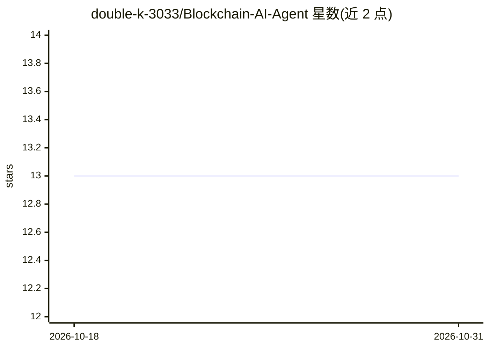

# double-k-3033/Blockchain-AI-Agent

⭐ 13 · TypeScript · 推送 2025-11-26 · [GitHub](https://github.com/double-k-3033/Blockchain-AI-Agent) · 个人维护

**多链区块链自主 AI Agent：监听、分析并执行链上交易**

面向开发者、交易者、DeFi 协议与区块链研究者的自主代理系统，支持 Ethereum、Polygon、BSC 等多链：实时监听链上事件、用 AI 分析交易/合约/钱包、按可编程策略执行交易，并支持本地 keystore 或外部签名器的密钥管理。技术栈为 lib/solana.js 与 ethers.js 做链交互，LangChain/Transformers 做 AI 层，FastAPI 与 PostgreSQL 为可选组件，Docker 容器化。通过 git clone 与 npm install 安装，配置 RPC URL、钱包密钥与 LLM API key 后 npm run build 运行；强化学习循环与 UI 仪表盘仍在路线图中未完成。

## 筛选速览

| 维度 | 判定 | 备注 |
|---|---|---|
| AI 角色 | `ai-native` | 本体是模型或模型工具 |
| 许可风险 | `none` | — |
| 部署形态 | `library` | 以包/库形式分发 |
| 模型依赖 | — | README 未给出锁定关系 |
| 硬件要求 | — | 无带数字的原话,不猜 |
| 安装摩擦 | `low` | 无编译、无系统依赖或容器化 |
| 成熟度 | — | 结构信号不足 |

## 能力要点

- 多链支持：Ethereum、Polygon、BSC 等（另含 Solana、Sui）
- 实时链上事件监听与 AI 异常检测/风险评分
- 本地 keystore 或外部签名器的密钥管理
- 可训练自定义策略的策略模块

## 适用场景

- 构建自主 DeFi 交易机器人
- 实时链上欺诈与异常检测
- 智能合约审计机器人
- NFT 市场抢购代理

## 场景标签

`金融量化` · 领域:学习与行业

## 证据(README 行号)

> L8: - **Monitor** blockchain activity across multiple networks
> L9: - **Analyze** transactions, smart contracts, and wallets using AI
> L10: - **Execute** transactions or smart contract interactions based on programmable strategies

## 星数曲线

2026-10-18 13 → 2026-10-31 13（+0）

---
*卡片 v1 · prompt 1.4 · 生成 2026-10-31 · 置信度 mid · 依据 README sha `80fce44e7aa5` · [字段定义](../../DATASET.md)*
