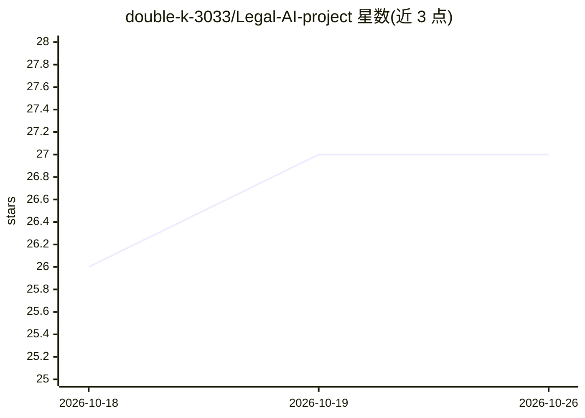

# double-k-3033/Legal-AI-project

⭐ 27 · TypeScript · 推送 2025-11-24 · [GitHub](https://github.com/double-k-3033/Legal-AI-project) · 个人维护

**面向用户的法律文档自动分析 Web 平台**

基于 Next.js 前端与 Flask 后端的 Web 应用，对法律文档做自动化分析：包含基于 SQuAD 数据集训练的阅读理解模型（从文档中抽取信息）、基于 T5-base 的改写模型（用 Quora/SQuAD 2.0/CNN 数据集帮助理解条款）、TextBlob 情感分析（分析条款影响），并自建了 500 份合同构成的 CUAD 问答数据集。前端通过 Flask 服务器连接机器学习侧，提供 Docker Compose 部署方式。免责声明指出不能替代专业法律意见。

## 筛选速览

| 维度 | 判定 | 备注 |
|---|---|---|
| AI 角色 | `ai-native` | 本体是模型或模型工具 |
| 许可风险 | `none` | — |
| 部署形态 | `self-host` | docker 或自建部署 |
| 模型依赖 | — | README 未给出锁定关系 |
| 硬件要求 | — | 无带数字的原话,不猜 |
| 安装摩擦 | `low` | 无编译、无系统依赖或容器化 |
| 成熟度 | — | 结构信号不足 |

## 能力要点

- 基于 SQuAD 数据集的阅读理解模型，从法律文档抽取信息
- 基于 T5-base 的条款改写模型（Quora/SQuAD 2.0/CNN 数据集）
- 自建 500 份合同的 CUAD 问答数据集
- TextBlob 情感分析分析条款影响

## 适用场景

- 上传合同后自动抽取关键信息与识别潜在风险
- 改写复杂条款帮助理解合同内容
- 签署合同前辅助判断条款影响

## 场景标签

`文档问答` · 领域:知识与检索

## 证据(README 行号)

> L14: - 📖 **Reading Comprehension Model**: We have developed and evaluated a reading comprehension model based on the SQu
> L10: The Automated Legal Document Analysis Platform is a powerful web application that automates the laborious process o

## 星数曲线

2026-10-18 26 → 2026-10-26 27（+1）

---
*卡片 v1 · prompt 1.4 · 生成 2026-10-26 · 置信度 high · 依据 README sha `009ce10ba52f` · [字段定义](../../DATASET.md)*
