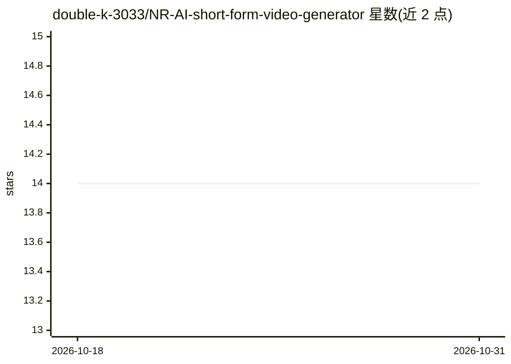

# double-k-3033/NR-AI-short-form-video-generator

⭐ 14 · Python · Apache-2.0 · 推送 2025-11-26 · [GitHub](https://github.com/double-k-3033/NR-AI-short-form-video-generator) · 个人维护

**文本提示生成短视频的多智能体应用，面向内容创作者**

基于 Google Agent Development Kit (ADK) 构建的短视频自动生成应用：编排 Agent 协调主题定义、研究、剧本撰写、语音旁白、图像与视频生成、视频合成及 SEO 优化等专职子 Agent，前端用 Streamlit 提供聊天界面。生成能力由 Gemini、Imagen、Veo 等 Google 生成模型驱动，需 Google API Key 或 ADC 认证。通过 Makefile 与 uv 启动后端 ADK 服务器和前端 UI，产物保存到项目目录。

## 筛选速览

| 维度 | 判定 | 备注 |
|---|---|---|
| AI 角色 | `ai-native` | 本体是模型或模型工具 |
| 许可风险 | `permissive` | Apache-2.0 |
| 部署形态 | `library` | 以包/库形式分发 |
| 模型依赖 | — | README 未给出锁定关系 |
| 硬件要求 | — | 无带数字的原话,不猜 |
| 安装摩擦 | `medium` | 含编译或系统依赖之一 |
| 成熟度 | — | 结构信号不足 |

## 能力要点

- 多 Agent 流水线：主题定义→研究→剧本→资产生成→视频合成→SEO 优化
- 语音旁白、图像与视频片段由 Gemini/Imagen/Veo 等 Google 模型生成
- 用户逐步确认主题与剧本，可反馈修改后再生成
- Streamlit 聊天式前端 + ADK 后端，Makefile 一键启动

## 适用场景

- 用一句话描述想法，让 Agent 产出带旁白与画面的短视频
- 内容创作者批量生成短片并自动获得 SEO 标题与描述
- 学习 ADK 多 Agent 编排的实际应用结构

## 场景标签

`多智能体` `视频生成` · 领域:Agent 开发

## 证据(README 行号)

> L5: **Neural Reels** is an AI-powered application that automates the creation of short-form video content from simple te
> L7: This project uses the Google Agent Development Kit (ADK) to build and orchestrate the agent-based workflow, with a u
> L18:  * `VoiceoverGeneratorAgent`: Creates audio narration for each scene using Text-to-Speech.
> L20:  * `ImageGeneratorAgent` & `VideoGeneratorAgent`: Generate images and video clips based on the prompts.

## 星数曲线

2026-10-18 14 → 2026-10-31 14（+0）

---
*卡片 v1 · prompt 1.4 · 生成 2026-10-31 · 置信度 mid · 依据 README sha `1b9c71ff72ee` · [字段定义](../../DATASET.md)*
