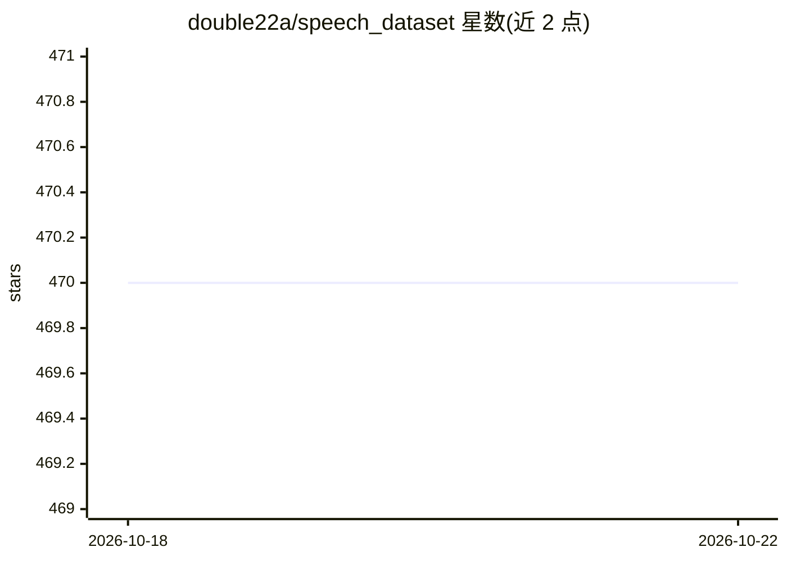

# double22a/speech_dataset

⭐ 470 · Apache-2.0 · 推送 2026-01-04 · [GitHub](https://github.com/double22a/speech_dataset) · 个人维护

**多语种语音数据集索引清单：ASR/TTS/说话人等任务分类收录**

按任务（语音识别、语音合成、识别+说话人分离、说话人识别、语音活动检测）与语言（中文、英文、中英混合、日韩俄法西土阿意等）组织的语音数据集索引清单：每条目给出名称、时长（小时）、下载地址与备注，覆盖 THCHS-30、WenetSpeech、LibriSpeech、Common Voice、VoxCeleb 等公开数据集及竞赛数据，另收录噪声与非语音数据（MUSAN、AudioSet）。仅为列表索引，不提供代码、下载脚本或安装方式。

## 筛选速览

| 维度 | 判定 | 备注 |
|---|---|---|
| AI 角色 | `ai-knowledge` | 知识聚合/清单类 |
| 许可风险 | `permissive` | Apache-2.0 |
| 部署形态 | `None` |  |
| 模型依赖 | — | README 未给出锁定关系 |
| 硬件要求 | — | 无带数字的原话,不猜 |
| 安装摩擦 | `low` | 无编译、无系统依赖或容器化 |
| 成熟度 | — | 结构信号不足 |

## 能力要点

- 按任务×语言双维度组织，覆盖 9 种以上语言
- 每条目含时长与下载地址，覆盖 ASR/TTS/说话人/VAD 任务
- 包含噪声与房间冲激响应等辅助数据集

## 适用场景

- 为语音识别模型训练挑选合适语种与时长的数据集
- 查找说话人分离、说话人识别任务的数据来源
- 获取 MUSAN 等噪声数据用于数据增强

## 场景标签

`精选清单` · 领域:学习与行业

## 证据(README 行号)

> L1: ## The Dataset of Speech Recognition
> L110: ## The Dataset of Speech Synthesis
> L140: ## The Dataset of Speaker Recognition

## 星数曲线

2026-10-18 470 → 2026-10-22 470（+0）

---
*卡片 v1 · prompt 1.4 · 生成 2026-10-21 · 置信度 high · 依据 README sha `07f0800a1bba` · [字段定义](../../DATASET.md)*
