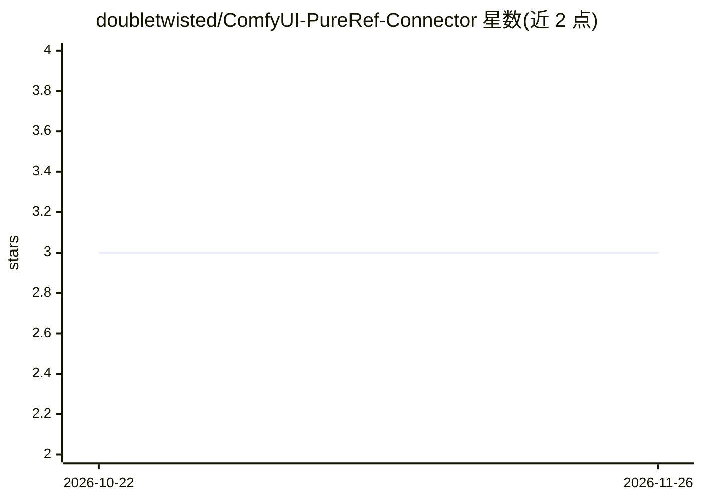

# doubletwisted/ComfyUI-PureRef-Connector

⭐ 3 · Python · MIT · 推送 2026-10-14 · [GitHub](https://github.com/doubletwisted/ComfyUI-PureRef-Connector) · 个人维护

**将 ComfyUI Save Image 输出发送到 PureRef 拼贴板的插件（仅 Windows）**

ComfyUI 自定义节点插件，把内置 Save Image 节点生成的图片自动发送到 PureRef 拼贴板，无需额外节点。通过 ComfyUI 工具栏按钮配置 .pur 文件路径并启用即可；新图片按行排列添加到画布左上角起始区域，可选择同时保存到输出文件夹或仅发往拼贴板。仅支持 Windows，PureRef 需运行在同一台电脑，且经 ComfyUI-Manager 安装或克隆到 custom_nodes 目录。

## 筛选速览

| 维度 | 判定 | 备注 |
|---|---|---|
| AI 角色 | `ai-enhanced` | 去掉 AI 部分产品仍成立 |
| 许可风险 | `permissive` | MIT |
| 部署形态 | `None` |  |
| 模型依赖 | — | README 未给出锁定关系 |
| 硬件要求 | — | 无带数字的原话,不猜 |
| 安装摩擦 | `low` | 无编译、无系统依赖或容器化 |
| 成熟度 | — | 结构信号不足 |

## 能力要点

- 无需添加节点，直接接入内置 Save Image 输出
- 可选仅发往 PureRef 或同时保存到输出文件夹
- 从 PureRef 导出图片（Format: Original）可还原工作流
- 发送失败时自动回退保存到常规输出文件夹并警告

## 适用场景

- 做 AI 图像生成时把产出自动收集到 PureRef 参考板
- 在 ComfyUI 工作流中集中管理生成的参考图与迭代版本

## 场景标签

`图像生成` · 领域:内容生成

## 证据(README 行号)

> L3: Sends images from the built-in **Save Image** node to a PureRef board. No extra nodes.
> L5: Windows only. Tested with PureRef 2.1.3.
> L13: Install **PureRef Connector** from ComfyUI-Manager, or clone this repo into `ComfyUI/custom_nodes`.

## 星数曲线

2026-10-22 3 → 2026-11-26 3（+0）

---
*卡片 v1 · prompt 1.4 · 生成 2026-11-26 · 置信度 high · 依据 README sha `f3eb0d42d6bf` · [字段定义](../../DATASET.md)*
