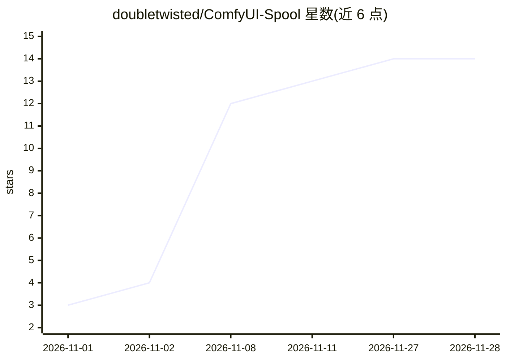

# doubletwisted/ComfyUI-Spool

⭐ 14 · JavaScript · GPL-3.0 · 推送 2026-11-11 · [GitHub](https://github.com/doubletwisted/ComfyUI-Spool) · 个人维护

**给 ComfyUI 用户加视频时间线的生成式影片工作台**

作为 ComfyUI 自定义节点运行的视频时间线工作室：在时间线上铺排分镜，按镜头排队运行用户已有工作流生成多条 take，比较后选定进入剪辑，支持修剪、配乐与导出，并可输出 OpenTimelineIO 供 Resolve/Premiere 使用。渲染可在本地 ComfyUI、Comfy Cloud 或 Deadline 农场执行；也提供脱离 ComfyUI 的独立编辑模式。需 ComfyUI 0.39+、Python 3.11+、ffmpeg/ffprobe；0.1.0 为早期版本，Linux 未测试。

## 筛选速览

| 维度 | 判定 | 备注 |
|---|---|---|
| AI 角色 | `ai-native` | 本体是模型或模型工具 |
| 许可风险 | `viral` | GPL-3.0 |
| 部署形态 | `desktop` | 安装包/桌面程序 |
| 模型依赖 | — | README 未给出锁定关系 |
| 硬件要求 | — | 无带数字的原话,不猜 |
| 安装摩擦 | `medium` | 含编译或系统依赖之一 |
| 成熟度 | `idea` | |

## 能力要点

- 时间线管理分镜、take 对比与选片、导出剪辑序列
- 无需在图中加入自定义节点，直接读取普通工作流
- 支持本地 ComfyUI、Comfy Cloud 与 Deadline 农场三种渲染路径
- 提供命令 API、CLI 与 spool-control 技能用于自动化

## 适用场景

- 用 ComfyUI 工作流逐镜头生成视频并比选 take
- 把 AI 生成的分镜组装成带音轨的序列
- 导出 OpenTimelineIO 到 DaVinci Resolve 或 Premiere 剪辑
- 在无 GPU 环境下通过 Comfy Cloud 渲染

## 场景标签

`视频生成` · 领域:内容生成

## 证据(README 行号)

> L13: Spool turns ComfyUI into a place to make a film, not just a shot. Lay out shots
> L14: on a timeline, generate takes for each one with your own workflows, compare
> L69: 4. Set the number of **Takes** and click **Generate**.

## 星数曲线

2026-11-01 3 → 2026-11-28 14（+11）

---
*卡片 v1 · prompt 1.4 · 生成 2026-11-18 · 置信度 high · 依据 README sha `f9e18fbdb181` · [字段定义](../../DATASET.md)*
