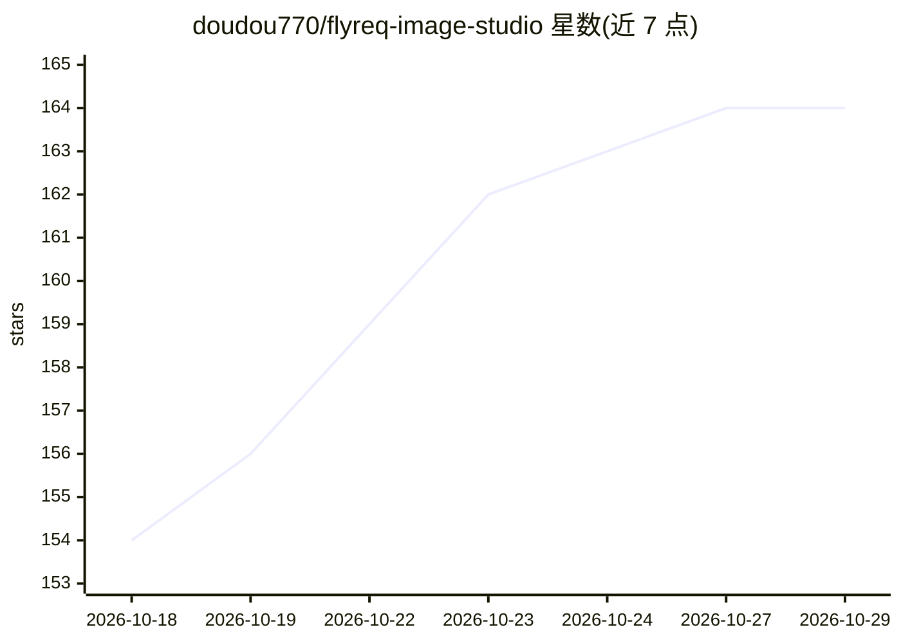

# doudou770/flyreq-image-studio

⭐ 164 · TypeScript · AGPL-3.0 · 推送 2026-09-25 · [GitHub](https://github.com/doudou770/flyreq-image-studio) · [官网](https://image.flyreq.com) · 个人维护 · 中文 README

**自托管 AI 生图/视频工作台，多模型接入与无限画布**

面向个人与团队的 AI 图片和视频创作工作台：前端 Next.js 16 + React 19 静态导出（PWA），后端 Node.js 服务（server.js + SQLite + WebSocket）统一调度任务并代理生成 API。支持文生图、图生图、GIF、视频生成、无限画布、Agent 多轮对话生成、提示词反推与提示词广场；图片/视频/文本模型均由用户自定义配置，兼容 Google、OpenAI、xAI 和 New API 协议。提供 Docker Compose 与 npm 两种部署方式，任务经 SQLite 队列持久化。

## 筛选速览

| 维度 | 判定 | 备注 |
|---|---|---|
| AI 角色 | `ai-native` | 本体是模型或模型工具 |
| 许可风险 | `viral` | AGPL-3.0 |
| 部署形态 | `self-host` | docker 或自建部署 |
| 模型依赖 | — | README 未给出锁定关系 |
| 硬件要求 | — | 无带数字的原话,不猜 |
| 安装摩擦 | `low` | 无编译、无系统依赖或容器化 |
| 成熟度 | — | 结构信号不足 |

## 能力要点

- 五大工作模式：文生图、图生图、Agent 对话生成、反推提示词、GIF 生成
- 多模型协议接入，兼容 Google/OpenAI/xAI/New API，支持自定义模型 ID
- 任务 SQLite 队列持久化、WebSocket 实时同步、断线回退轮询
- URL 外链预填模型配置（provider 参数），用户确认后才保存

## 适用场景

- 自建一个支持多厂商模型的生图与视频生成工作台
- 通过 Agent 对话式地制定方案并生成图片
- 在无限画布上组织 AI 生成的素材并进行创作

## 场景标签

`图像生成` `视频生成` · 领域:内容生成

## 证据(README 行号)

> L15: FlyReq Image Studio（简称 FlyReq Image）是一个面向个人与团队的 AI 图片和视频创作工作台。前端使用 Next.js 16 + React 19 静态导出（PWA），后端是轻量 Node.js 服务
> L21: - **图像视频一体化**：支持文生图、图生图、GIF、视频生成和无限画布创作

## 星数曲线

2026-10-18 154 → 2026-10-29 164（+10）

---
*卡片 v1 · prompt 1.4 · 生成 2026-10-22 · 置信度 high · 依据 README sha `9616290466aa` · [字段定义](../../DATASET.md)*
