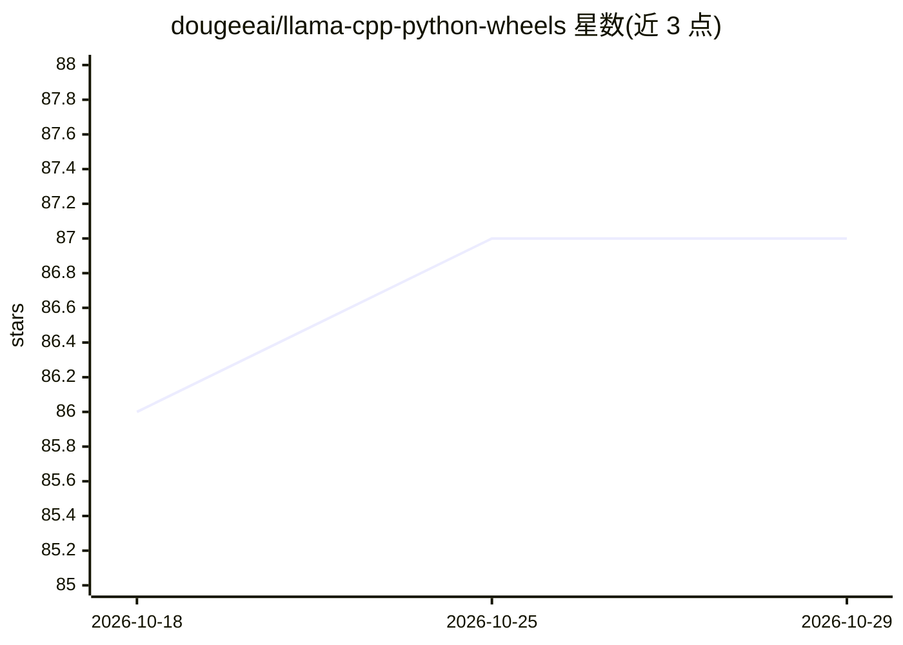

# dougeeai/llama-cpp-python-wheels

⭐ 87 · MIT · 推送 2026-04-18 · [GitHub](https://github.com/dougeeai/llama-cpp-python-wheels) · 个人维护

**llama-cpp-python 的预编译 CUDA wheel 分发：免本地编译安装**

为 llama-cpp-python 0.3.16/0.3.20 提供 Windows 平台预编译 CUDA wheel，覆盖 Turing(sm_75)、Ampere(sm_86)、Ada(sm_89)、Blackwell(sm_100/sm_120) 架构及 CUDA 11.8/12.1/13.0 组合，Python 3.10–3.13。面向在 NVIDIA GPU 上运行 llama-cpp-python 的用户，免去自行编译。运行时要求目标机器安装与 wheel 匹配的 CUDA Toolkit（含 cublas64_XX.dll），仅装驱动不够。0.3.20 wheel 采用 py3-none 标签，单 wheel 支持多 Python 版本。安装方式为从 Releases 下载后 pip install 本地 whl 文件。

## 筛选速览

| 维度 | 判定 | 备注 |
|---|---|---|
| AI 角色 | `ai-ecosystem` | LLM/agent 周边工具 |
| 许可风险 | `permissive` | MIT |
| 部署形态 | `library` | 以包/库形式分发 |
| 模型依赖 | — | README 未给出锁定关系 |
| 硬件要求 | — | 无带数字的原话,不猜 |
| 安装摩擦 | `medium` | 含编译或系统依赖之一 |
| 成熟度 | — | 结构信号不足 |

## 能力要点

- 覆盖 Turing/Ampere/Ada/Blackwell 四代架构的 Windows CUDA wheel
- 提供 CUDA 11.8/12.1/13.0 多版本组合（0.3.16 与 0.3.20）
- 0.3.20 wheel 使用 py3-none 标签，单个 wheel 支持 Python 3.10–3.13
- 附安装验证代码片段

## 适用场景

- 在 RTX 30/40/50 系列 GPU 上免编译安装 llama-cpp-python
- 按自己机器的 CUDA 版本与显卡架构选择对应预编译包
- 避免 Windows 上搭建 Visual Studio/CUDA 编译环境

## 场景标签

`推理引擎` · 领域:训练与推理

## 证据(README 行号)

> L2: Pre-built wheels for llama-cpp-python across platforms and CUDA versions.
> L82: Download the appropriate wheel from Releases and install:

## 星数曲线

2026-10-18 86 → 2026-10-29 87（+1）

---
*卡片 v1 · prompt 1.4 · 生成 2026-10-24 · 置信度 high · 依据 README sha `e74bbbb392f9` · [字段定义](../../DATASET.md)*
